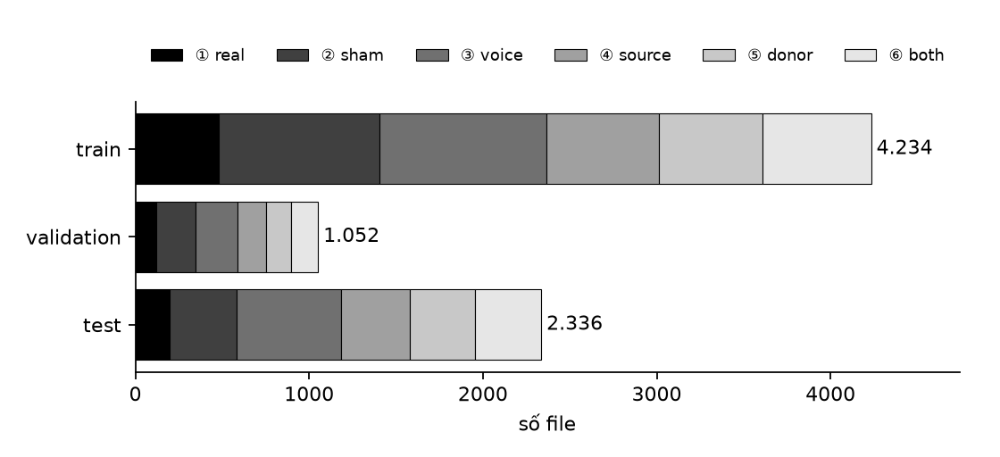
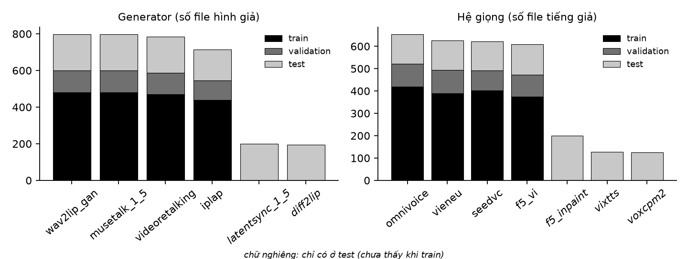
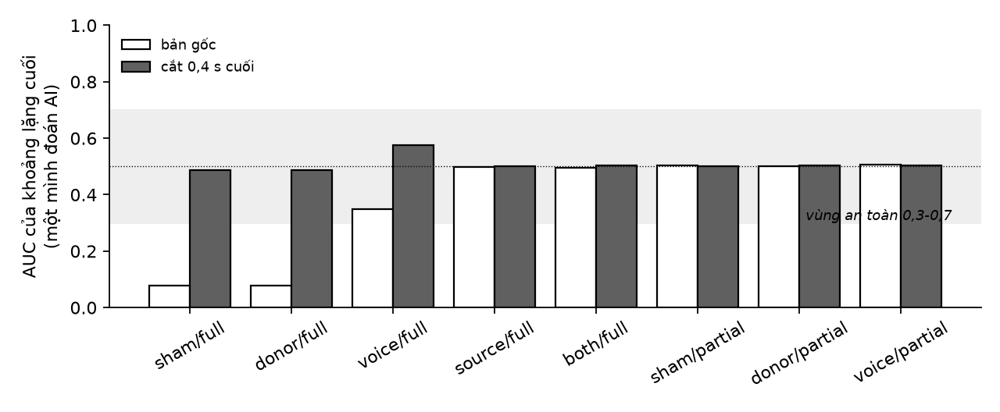
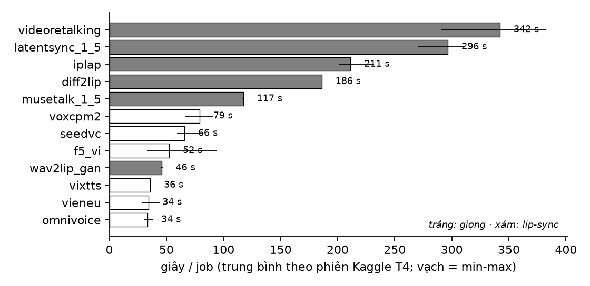
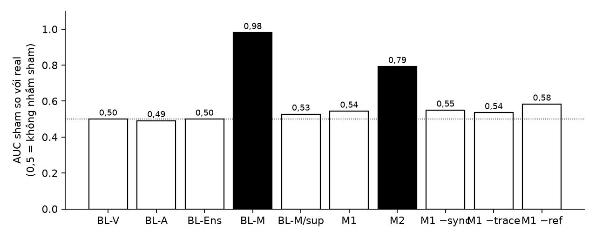
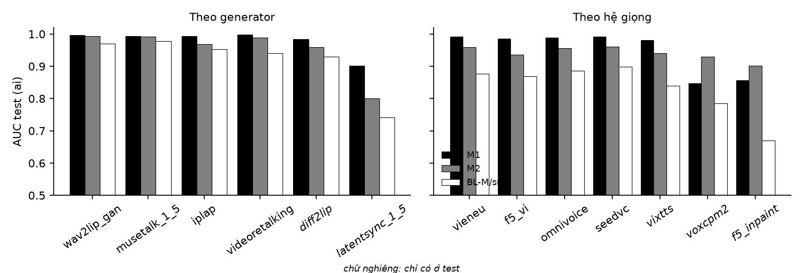

> Bản sao từ nhật ký nghiên cứu (`RESEARCH_WORKLOG/v003_generation.md`, ngoài repo) ngày 26/10/2026. Sửa ở nhật ký rồi chép lại vào đây.

# v003 · Sinh fake: sáu ô, generator, giọng và bộ part 1

Báo cáo nghiên cứu phần **sinh dữ liệu giả** của VN-AV-DF v003 (benchmark phát hiện lip-sync deepfake nghe-nhìn tiếng Việt). Cập nhật **26/10/2026** (số liệu part 1 đã sinh xong và đã dùng để train / test).

File 2/3 của v003:
- [v003_data.md](v003_data.md): dữ liệu real (đầu vào của file này).
- **v003_generation.md** (file này): thiết kế sáu ô, generator và giọng, số lượng, cân bằng, chặn lối tắt, chạy sinh trên Kaggle, thống kê bộ part 1, lỗi và thay đổi.
- [v003_model.md](v003_model.md): mô hình phát hiện, huấn luyện, kết quả test part 1.

Code: `vn-av-df-forensics/src/vn_av_df/generation/`, script `generation/00-04_*.py`, notebook `notebooks/generate.ipynb`, cắt 0,4 s cho part 1: `tools/trim_part1.py`. Dữ liệu: `vn-av-df-data-part1_fake/` (bản sinh gốc, giữ nguyên làm bằng chứng) và `vn-av-df-data-part1_trim04_fake/` (bản đã cắt, dùng để train; Kaggle dataset `vn-av-df-data-part1-trim04-fake`). Hình: `figures/v003/g*.png`.

---

## Cách đọc file này

**Phạm vi.** Từ một part real hoàn chỉnh (v003_data §4.7) tới một bộ dữ liệu có nhãn (manifest) gồm real và năm loại biến đổi. Kết quả phát hiện chỉ được nhắc khi nó trả lời câu hỏi về **dữ liệu** (ô nào cần, generator nào khó); kết quả mô hình đầy đủ ở v003_model.

**Đây là báo cáo đồ án, không phải paper**: ghi đủ tham số kèm lý do, các phương án bị bác, lỗi đã mắc, số đo trước và sau.

**Mức bằng chứng:**
- **●** đo trên dữ liệu của mình (part 1, sinh 20-23/10/2026; số liệu chụp từ manifest, `generation.json`, `records/`, `shortcut_audit.json` ngày 26/10);
- **✔** đọc từ paper gốc / trang chính thức / mã nguồn chính thức;
- **◐** chỉ đọc abstract hoặc nguồn thứ cấp;
- **○** suy luận, ước lượng hoặc lựa chọn thiết kế.

**Riêng tư.** Dữ liệu là video công khai của người thật. File này không nêu tên người, kênh, tiêu đề, mã video, mã speaker. Hình trong file chỉ là biểu đồ số liệu.

**Ai làm.** Thiết kế và code sinh: nhóm (Claude hỗ trợ code); chạy sinh part 1 trên Kaggle: đồng đội, trên nhánh `claude/project-thread-4cdb4b`, sau đó gộp vào `main` (23/10).

---

## Tóm tắt

Benchmark lip-sync deepfake cần dữ liệu giả **cùng nguồn** với dữ liệu thật, **đủ đa dạng** về cách giả và **không mang dấu hiệu cấu trúc** nào giúp đoán nhãn mà không cần nhìn nội dung. Phần này biến mỗi clip real thành 9 (train / validation) hoặc 12 (test) file thuộc **sáu ô**: ① real, ② sham (tiếng thật của chính người đó ở clip khác, *không phải AI*), ③ voice (giọng AI), ④ source, ⑤ donor (môi do generator vẽ lại) và ⑥ both (môi giả + một cụm giọng AI). Mỗi ô trừ ① có bản **full** và **partial** (một đoạn 0,3-3 s). Bốn generator và bốn hệ giọng dùng chung cho train / validation / test; **hai generator họ diffusion và ba hệ giọng chỉ có ở test** để đo khả năng tổng quát.

Part 1 (sinh 20-23/10/2026 ●): **800 clip real của 40 người → 7.622 file**, 10,6 giờ video, 69 % có thành phần AI. 1.744 / 1.800 lần chạy lip-sync thành công (3,1 % bị bỏ, chủ yếu do generator không thấy mặt); 54,6 giờ phiên Kaggle (≈ 109 giờ GPU T4). Kiểm lối tắt phát hiện **khoảng lặng cuối** của ② sham full và ⑤ donor full đoán được nhãn (AUC 0,08) → part 1 được **cắt 0,4 s cuối mọi file** (AUC về 0,49, không còn cờ), part sau sửa ngay ở bước sinh (`donor_fit`). Kết quả mô hình xác nhận hai lựa chọn thiết kế: detector chỉ đo độ khớp tiếng-môi báo nhầm **98 %** clip sham là giả (vì sao cần ô ②), và generator / giọng chỉ có ở test khó hơn rõ rệt (LatentSync, VoxCPM2, F5 inpainting).

| Hạng mục | Part 1 ● | Mục |
|---|---|---|
| Clip real → file | 800 → **7.622** (train 4.234 · validation 1.052 · test 2.336) | §5.2 |
| Người | 40 (20 nữ, 20 nam); split 24 / 6 / 10 theo người | §5.2 |
| Ô | ① 800 · ② 1.534 · ③ 1.800 · ④ 1.212 · ⑤ 1.112 · ⑥ 1.164 | §5.2 |
| Nhãn | AI 69,4 % · hình giả 45,8 % · tiếng giả 38,9 % · lệch tiếng-môi 43,7 % | §5.2 |
| Generator | Wav2Lip-GAN, MuseTalk 1.5, IP-LAP, VideoReTalking · **chỉ test: LatentSync 1.5, Diff2Lip** | §3.3 |
| Giọng | VieNeu-TTS v3, F5-TTS VN, OmniVoice, Seed-VC · **chỉ test: VoxCPM2, viXTTS, F5 inpainting** | §3.3 |
| Lối tắt | trước cắt: 2 cờ (khoảng lặng cuối, AUC 0,08) · sau cắt 0,4 s: 0 cờ | §5.3 |
| Chi phí | 24 phiên Kaggle, 54,6 giờ phiên; lip-sync 46-342 s / job | §5.4 |

---

# Chương 1. Giới thiệu

## 1.1. Bối cảnh

Một detector chỉ đáng tin khi được đánh giá trên dữ liệu giả **giống cách kẻ xấu làm**: lip-sync (vẽ lại miệng theo tiếng mới), giọng nhân bản, hoặc cả hai, và cả kiểu **sửa một đoạn ngắn** trong câu thật. Các bộ dữ liệu nghe-nhìn lớn (FakeAVCeleb, AV-Deepfake1M) đều tiếng Anh; chưa tìm thấy bộ lip-sync có hình bằng tiếng Việt (v003_data §1.2). Vì vậy phải tự sinh dữ liệu giả từ chính các clip real đã thu.

## 1.2. Khoảng trống của các bộ hiện có

| Vấn đề | Bằng chứng | Hệ quả cho thiết kế |
|---|---|---|
| Không tách "lệch tiếng" với "AI" | FakeAVCeleb, AV-Deepfake1M không có mẫu tiếng thật nhưng lệch môi ✔; detector đo độ khớp coi mọi lệch là giả (v001: báo nhầm 88 % sham ●) | thêm ô ② **sham** (§3.1) |
| Lối tắt cấu trúc | Smeu et al. CVPR 2025 ✔: chỉ nhìn khoảng lặng đầu clip đạt > 98 % trên FakeAVCeleb, AV-1M | kiểm lối tắt bắt buộc trước khi train (§4.4) |
| Ít họ generator, học thuộc dấu vết | Scaling Laws ✔: số phương pháp giả là trục giúp tổng quát (α = 0,375); v001: Wav2Lip 0,98 → MuseTalk 0,55 ● | nhiều họ generator / giọng; giữ riêng họ cho test (§3.3) |
| Fake khác nguồn với real | GenD (WACV 2026) ✔: fake cùng nguồn với real hơn +4,7 AUC trung bình trên 14 bộ | mọi fake sinh từ chính clip real (paired) |
| Thiếu kiểu sửa một đoạn | LAV-DF, AV-1M có ✔; PartialEdit (Interspeech 2025) ✔: detector train trên kiểu ghép kém với kiểu sửa bằng model | full + partial; track C (inpainting) chỉ ở test |

## 1.3. Bài học từ v001 / v002

| Bài học | Nguồn | Yêu cầu |
|---|---|---|
| Sync-only báo nhầm 88 % clip lệch tiếng thật ● | v001 | ô ② sham cả lúc train và test |
| Nhánh artifact train trên Wav2Lip: 0,979 trên Wav2Lip, 0,553 trên MuseTalk ● | v001 | nhiều generator khác họ |
| Sinh ở 640 px → miệng mờ → AUC 0,99, quá dễ ● | v002 | sinh giữ nguyên độ phân giải (≤ 720p) |
| Nhánh artifact học dấu vết xử lý (nén, đổi cỡ) ● | v002 E6 | encode lại **mọi** file kể cả real, cùng cấu hình |

## 1.4. Mục tiêu

1. Mỗi clip real sinh đủ sáu ô (trừ trường hợp generator lỗi), **cân bằng** số lần chạy giữa generator và giữa ô.
2. Có generator và giọng **chưa thấy** ở test.
3. **Không** đặc trưng cấu trúc nào (khoảng lặng, độ dài, độ to) một mình đoán được nhãn: AUC trong [0,3; 0,7].
4. Chạy được trên quota Kaggle (2×T4, 30 giờ / tuần / tài khoản), dừng / chạy tiếp được.
5. Ghi đủ nhật ký để tái lập (record từng job, nhật ký phiên).

## 1.5. Câu hỏi nghiên cứu (phần sinh)

Câu hỏi chính: **sinh thế nào để bộ dữ liệu giả đủ đa dạng, cân bằng, không lối tắt, đo được cả khả năng tổng quát, trong quota Kaggle?**

| Mã | Câu hỏi | Trả lời ở |
|---|---|---|
| RQ-G1 | Bộ sinh ra có đúng kế hoạch và cân bằng (ô, generator, giọng, split, giới)? | §5.2 (G00) |
| RQ-G2 | Có đặc trưng cấu trúc nào đoán được nhãn? Sửa thế nào? | §5.3 (G01) |
| RQ-G3 | Chi phí và tỉ lệ lỗi theo generator / giọng? | §5.4 (G02) |
| RQ-G4 | Ô ② sham có thật sự cần? | §5.5 (G03) |
| RQ-G5 | Generator / giọng nào khó phát hiện nhất; giữ riêng cho test có tạo được bài khó? | §5.6 (G04) |

## 1.6. Đóng góp

- Thiết kế sáu ô có đối chứng **lệch tiếng thật** (sham), với nhãn tách bốn câu hỏi (AI / hình / tiếng / lệch).
- Bộ part 1: 7.622 file lip-sync + giọng AI tiếng Việt, 6 generator, 7 hệ giọng, có partial và nhãn theo frame.
- Cách gán generator cân bằng thật sự (phát hiện và sửa lỗi xoay vòng, §3.5).
- Kiểm lối tắt bắt buộc, phát hiện và sửa một lối tắt thật trên dữ liệu đã sinh (§5.3).

---

# Chương 2. Tổng quan tài liệu

## 2.1. Các bộ nghe-nhìn sinh fake thế nào

| Bộ | Fake / real, cách rút phương pháp ✔ | Ghi chú |
|---|---|---|
| AV-Deepfake1M | fake / real = 2,997 / 2,9996 ở train / test → mỗi real đúng 3 fake (tiếng / hình / cả hai) ○; phương pháp **rút cho từng fake**; ⌈độ dài / 10 s⌉ chỗ sửa | ít fake mỗi real |
| AV-Deepfake1M++ | 2,27 tổng (train 2,70; validation 2,82; testA 1,88; testB 1,03); pool 3 lip-sync, 4 TTS | test có real không đủ 3 fake |
| LAV-DF | 62,72 % video 1 đoạn, 10,55 % 2 đoạn; đoạn trung bình 0,65 s, 89 % < 1 s | partial ngắn |
| FakeAVCeleb | 4 tổ hợp RVRA / RVFA / FVRA / FVFA; lệch nặng (≈ 39 fake / real) | bị chê mất cân bằng |
| FaceForensics++ / KoDF / DFDC / Celeb-DF | 4 / ~2,8 / ~5 / ~9,6 fake mỗi real | chỉ hình |

Tương ứng với sáu ô của v003: ① RVRA, ③ RVFA, ④⑤ FVRA, ⑥ FVFA (một phần tiếng). Ô ② sham không có trong các bộ trên.

## 2.2. Số fake mỗi real và tỉ lệ lớp

- **GenD** (WACV 2026) ✔: fake cùng nguồn (paired) hơn không paired +4,7 AUC trung bình trên 14 bộ, cùng tổng số video.
- **Scaling Laws** (2025) ✔: số phương pháp giả là trục có lợi (α = 0,375); thêm mẫu từ cùng nguồn lợi ít.
- **Layton et al.** (USENIX Security 2024) ✔: train 90 % fake thì trên tập toàn real báo nhầm nhiều hơn báo đúng; tỉ lệ train, ngưỡng và tỉ lệ ngoài thực tế phải khớp → v003 giữ tỉ lệ vừa phải và đặt ngưỡng theo FPR (v003_model §8).

## 2.3. Lối tắt trong dữ liệu deepfake

Smeu et al. (CVPR 2025) ✔ cho thấy khoảng lặng ở đầu clip một mình phân biệt real / fake > 98 % trên FakeAVCeleb và AV-Deepfake1M; detector "học" được đó là lối tắt chứ không phải dấu vết giả. Fake-or-JPEG (ECCVW 2024) ✔: khác biệt nén / kích thước cũng thành lối tắt. Bài học: **mọi thao tác chỉ áp cho fake** (co giãn tiếng, ghép, encode) đều có thể để lại dấu vết cấu trúc.

## 2.4. Partial và kiểu sửa

- Không tìm thấy nghiên cứu đối chứng cho thấy train nhiều đoạn giúp định vị; clip v003 dài 4-7 s nên **1 đoạn** đúng chuẩn AV-1M (⌈độ dài / 10 s⌉).
- Detector partial-spoof bên audio dễ bám vết nối overlap-add (survey 2025 ◐) → v003 trộn mép hình 50 % cắt thẳng / 50 % trộn mượt, và ghép tiếng track B giống hệt sham.
- PartialEdit (Interspeech 2025) ✔: train trên kiểu ghép phát hiện kém kiểu sửa bằng model → track C (F5 inpainting) chỉ ở test.

## 2.5. Generator và giọng tiếng Việt

- Lip-sync: GAN (Wav2Lip), latent một bước (MuseTalk), landmark → render (IP-LAP), nhiều tầng (VideoReTalking), latent diffusion (LatentSync), diffusion trên pixel (Diff2Lip).
- Giọng: VietPrism ✔ (deepfake giọng tiếng Việt) cho thấy hệ khó phát hiện nhất là MiniMax (EER 37 %) và **VoxCPM2 (35 %)**, dễ nhất OmniVoice (15 %).
- MAVOS-DD, TalkingHeadBench ✔ cũng giữ riêng generator cho test.

---

# Chương 3. Thiết kế

## 3.1. Sáu ô

|  | Tiếng gốc | Tiếng thật của clip khác | Giọng AI |
|---|---|---|---|
| **Hình thật (môi gốc)** | ① real | ② sham | ③ voice |
| **Môi do generator vẽ lại** | ④ source | ⑤ donor | ⑥ both |

| Ô | Cách tạo | AI? | Phần bị giả | Tiếng khớp môi? |
|---|---|---|---|---|
| ① **real** | clip gốc | 0 | - | khớp |
| ② **sham** | giữ hình, thay tiếng bằng tiếng thật của **chính người đó** ở clip khác | **0** | - | **không** |
| ③ **voice** | giữ hình, thay tiếng bằng **giọng AI** nhân bản giọng người đó | 1 | tiếng | không |
| ④ **source** | generator vẽ lại môi theo **tiếng gốc** | 1 | môi | khớp |
| ⑤ **donor** | generator vẽ môi theo **tiếng thật của clip khác** cùng người, rồi dùng tiếng đó | 1 | môi | khớp |
| ⑥ **both** | sửa **một cụm** trong câu thành giọng AI (track B), generator vẽ môi theo tiếng đã sửa | 1 | môi + cụm tiếng | khớp |

"Clip khác" ở ② và ⑤, và giọng mẫu để nhân bản, luôn là clip của **cùng người, cùng split** (cố định theo seed).

Lý do từng thành phần:
- **② sham** tách "có AI không" khỏi "tiếng có khớp môi không". Thiếu nó, detector học "lệch = giả" (v001: báo nhầm 88 % sham ●; part 1: BL-M báo nhầm 98 %, §5.5).
- **Cùng người**: khác người thì chỉ cần nhận "giọng này không phải người trong hình", quá dễ.
- **⑤ donor**: môi khớp tiếng hoàn toàn nhưng câu nói là mới; generator phải vẽ miệng khác hẳn.
- **⑥ track B** (sửa vài chữ: tên, số, "có" ↔ "không") mô phỏng kiểu sửa lời khó phát hiện; cặp ③ ↔ ⑥ cùng tiếng, chỉ khác hình.

## 3.2. Full, partial và ba track giọng

- Mỗi ô (trừ ①) ra **full** (giả cả clip) và **partial** (một đoạn 0,3-3 s, cách hai đầu ≥ 0,5 s). Full và partial lấy từ **cùng một lần chạy** generator (partial ghép đoạn giả vào video gốc), nên partial không tốn thêm GPU.
- Chỗ nối hình: 50 % cắt thẳng, 50 % trộn mượt 2-6 frame.

| Track | Cách làm | Split |
|---|---|---|
| **A** (③ full) | PhoWhisper lấy lời; TTS đọc lại cả câu bằng giọng nhân bản; co giãn ≤ ±15 % cho vừa độ dài | mọi split |
| **B** (③ partial, ⑥) | đổi một cụm (từ, số, tên), TTS cụm mới, ghép vào tiếng gốc: crossfade 15 ms, khớp độ to, phủ tiếng nền — **giống hệt hàm ghép của ② sham partial** | mọi split |
| **C** (③ partial) | F5 inpainting sửa trực tiếp đoạn theo ngữ cảnh câu, nối 5 ms | **chỉ test** |

## 3.3. Generator và hệ giọng

| | train / validation / test | chỉ test |
|---|---|---|
| Generator | Wav2Lip-GAN, MuseTalk 1.5, IP-LAP, VideoReTalking | **LatentSync 1.5, Diff2Lip** (họ diffusion) |
| Giọng (track A / B) | VieNeu-TTS v3, F5-TTS tiếng Việt, OmniVoice, TTS → Seed-VC | **VoxCPM2, viXTTS** |
| Track C | - | **F5 inpainting** |

| Generator | Họ | Giấy phép | Giây / job đo ● (Kaggle T4) |
|---|---|---|---|
| Wav2Lip-GAN | GAN, vẽ 96 px | chỉ nghiên cứu | 46 |
| MuseTalk 1.5 | latent VAE 1 bước, 256 px | MIT | 117 |
| IP-LAP | landmark → render | Apache-2.0 (weight qua OneDrive) | 211 |
| VideoReTalking | nhiều tầng, làm nét mặt | Apache-2.0 | 342 |
| LatentSync 1.5 | latent diffusion | Apache-2.0 | 296 |
| Diff2Lip | diffusion trên pixel | CC BY-NC 4.0 | 186 |

Lý do: mỗi generator / hệ giọng một họ khác nhau (học thuộc một họ thì không tổng quát; Scaling Laws ✔); **giữ riêng họ diffusion cho test** để đo "chưa từng thấy diffusion thì có phát hiện được không"; sinh giữ nguyên 720p (bài học v002). Loại: PC-AVS (chỉ crop 224 px), DINet (cần OpenFace Windows). Thay khi triển khai (15/10): VieNeu v2 → v3; Higgs Audio v3 → viXTTS (Higgs cần server riêng, giấy phép phi thương mại). **Giấy phép**: vài generator / TTS chỉ phi thương mại → dữ liệu để private.

## 3.4. Bao nhiêu fake mỗi clip real

|  | train | validation | test |
|---|---|---|---|
| ① real | 1 | 1 | 1 |
| ② sham (full + partial) | 2 | 2 | 2 |
| ③ voice | 2 (A, B) | 2 (A, B) | 3 (A, B, C) |
| ④⑤⑥: generator mỗi clip × 2 (full + partial) | 2 × 2 = 4 | 2 × 2 = 4 | 3 × 2 = 6 |
| **File mỗi clip real** | **9** | **9** | **12** |

Phương án được chọn (18/10) là **C: mọi clip real đều có fake, mỗi clip một nửa số generator** (so với A: 10 clip sinh fake + 10 real_only; B: mọi generator trên mọi clip):

| | A | B | **C** |
|---|---|---|---|
| Clip real có fake đi kèm (part 50 người cũ) | 500 | 1.000 | **1.000** |
| Có AI / không AI | 74 / 26 % | 79 / 21 % | **69 / 31 %** |
| Lần chạy lip-sync | 2.240 | 4.480 | **2.240** |
| Một clip real lặp trong bao nhiêu file AI | 10-15 | 10-15 | **6-9** |

C có cùng chi phí GPU với A nhưng gấp đôi clip real làm nền, lớp cân hơn, mỗi clip lặp ít hơn — khớp "đa dạng hơn lặp lại" (Scaling Laws) và cách AV-1M làm. Mất: không còn "mọi generator trên cùng clip". Full factorial (mọi generator × ô × giọng) là 59 / 124 mẫu mỗi clip, bỏ từ 15/10.

## 3.5. Gán generator vào ô: cân bằng thật sự

Mô phỏng 18/10 ● cho thấy cách xoay vòng cũ **không cân**: [source, donor, both] mỗi generator 120 / 90 / 90 ở train (lệch 33 %, vì 10 clip / người không chia hết cho 3), và ở test 3 cặp generator **luôn chung ô**. Cách hiện hành (`plan.py`: `assign_generators`, `cell_index`):
- gán theo **vòng** trên cả split: mỗi vòng mỗi generator chạy đúng 1 clip → số lần chạy mỗi generator bằng nhau;
- ô của mỗi generator xoay đều, lệch theo thứ tự người → mỗi generator chia đều ④ / ⑤ / ⑥ (sau sửa: 100 / 100 / 100);
- trong một clip các generator luôn ở ô khác nhau; cặp chung clip đổi theo khối;
- giọng 1 hệ mỗi clip, xoay theo clip, lệch theo người.

Kết quả trên part 1 thật: §5.2.

---

# Chương 4. Pipeline và cách chạy

## 4.1. Các bước

| Bước | Lệnh / phiên | Làm gì |
|---|---|---|
| 0 | `generation/00_setup.py` | tải source / weight generator (commit đã pin) |
| 1 | `generation/01_plan.py` | kế hoạch cả part (ô, generator, giọng, tiếng ghép, donor), cố định theo seed |
| 2 | phiên **voice** (`PHASE = "voice"`, GPU) | ① ② ③ + track B cho ⑥; chạy **trước** lip-sync |
| 3 | các phiên **lipsync** (`GENERATORS = [...]`) | ④ ⑤ ⑥, mỗi phiên vài generator; nhiều notebook song song, phiên sau attach Output phiên trước (`PREVIOUS_OUTPUT`) |
| 4 | `generation/04_finalize.py` | gom `manifest.jsonl` có nhãn + `shortcut_audit.json` |

- Mỗi job ghi `records/<key>.json` (dòng manifest, hoặc lý do bị bỏ). Hết giờ thì chạy lại; job dở xoá và làm lại.
- Lỗi riêng một clip (không thấy mặt, generator lỗi) thì bỏ job, ghi lý do; bỏ 10 job liên tiếp thì dừng phiên.
- Bước sinh **không ghi W&B** (chốt 18/10); nhật ký ở `generation.json` (mỗi phiên: thời gian, số job xong / bỏ, giây / job theo phương pháp) và `records/`.

## 4.2. Chuẩn hoá đầu ra

Mọi file, **kể cả real**, được encode lại cùng một cấu hình `h264-crf18-aac48k` (H.264 CRF 18, 25 fps, ≤ 720p, AAC 48 kHz mono): real và fake không khác nhau về nén / kích thước (bài học v002 E6). Real giữ đúng độ lệch tiếng-hình đã sửa về 0 ở bước dữ liệu (v003_data §4.3).

## 4.3. Nhãn

Mỗi dòng manifest có: split, người, giới, ô, full / partial, generator, giọng, đoạn partial, và bốn nhãn — `label` (AI?), `synthetic_visual`, `synthetic_audio`, `av_mismatch_intervals` — cùng đoạn giả theo thời gian (`fake_intervals`, `visual_fake_intervals`, `audio_fake_intervals`) để có nhãn theo frame (0,04 s). Nhãn tính bằng một hàm duy nhất `cells.labels`.

## 4.4. Chặn lối tắt

| Lối tắt | Cách chặn / kiểm |
|---|---|
| Khác biệt nén, độ phân giải, fps | encode lại mọi file, kể cả real, cùng cấu hình |
| Độ lệch tiếng-hình real ≠ fake | real dịch về 0 khi export (v003_data §4.3) |
| Khoảng lặng đầu / cuối, độ to, độ dài | `shortcut_audit.json`: AUC của từng đặc trưng một mình đoán nhãn AI, theo từng ô so với real; **ngoài [0,3; 0,7] là cờ đỏ**, phải sửa trước khi train |
| Vết ghép tiếng | track B ghép giống hệt ② sham |
| Vết nối hình ở partial | 50 % trộn mượt 2-6 frame |
| Real và fake khác nguồn | mọi fake sinh từ chính clip real |
| Clip tham chiếu lẫn vào phép đo | ref-norm bỏ clip tham chiếu và mọi file sinh từ chúng; tham chiếu cố định khi chấm bỏ clip gốc của chính mẫu (v003_model §8) |

## 4.5. Sửa sau part 1: `donor_fit` và cắt 0,4 s

Lối tắt khoảng lặng cuối (§5.3) có hai cách xử lý:
- **Part sau (sửa gốc, 23/10)**: `donor_fit` chọn cửa sổ tiếng donor đối xứng gần nhất với độ dài clip đích; khoảng lặng đầu / cuối bằng đúng của clip gốc; phần dư kéo dài khoảng nghỉ dài nhất bên trong câu; tiếng nền giảm ≤ mức đỉnh cửa sổ − 33 dB; pool donor gồm mọi clip dài ≥ clip gốc − 1 s, chọn donor vừa nhất (nên clip dài nhất cũng có sham). Mô phỏng trên part 1: AUC khoảng lặng cuối 0,08 → 0,55 ●.
- **Part 1 (không sinh lại)**: cắt **0,4 s (10 frame) cuối của mọi file**, real lẫn fake, bằng cùng một bước encode lại (`tools/trim_part1.py`); nhãn tính lại bằng `cells.labels` (đoạn partial luôn cách mép ≥ 0,5 s nên không mất nhãn); kiểm lại bằng audit. Chạy 1,4 giờ trên CPU 16 luồng ●.

Các sửa khác cho part sau (chỉ chạy khi cách cũ lỗi, không đổi dữ liệu đang có): IP-LAP crop quanh mặt khi crop gốc lỗi; VideoReTalking dò mặt bằng S3FD khi dlib trượt; Diff2Lip giảm batch 32 → 8 → 2 khi hết VRAM; record cũ hợp lệ được giữ (`still_valid`).

## 4.6. Đầu ra

| Đường dẫn | Nội dung |
|---|---|
| `<part>/clips/` | toàn bộ mp4 (real + fake), cùng một cấu hình encode |
| `<part>/manifest.jsonl` | mỗi dòng một file + nhãn (§4.3) |
| `<part>/shortcut_audit.json` | kiểm lối tắt (§4.4) |
| `<part>/generation.json`, `records/`, `asr/`, `tracks/` | nhật ký phiên, record từng job, lời PhoWhisper, track giọng (chỉ bản sinh gốc) |
| `<part>/dataset_info.json` | số mẫu, sha256 manifest; bản cắt ghi thêm `trim_end_s` và sha manifest gốc |

---

# Chương 5. Thí nghiệm và kết quả (part 1)

## 5.1. Phương pháp chung

Số liệu tính trên manifest của **bản đã cắt** (bản dùng để train / test), so với bản gốc khi cần; nhật ký phiên từ `generation.json`, lý do bỏ job từ `records/`. Script phân tích (`gen_stats.py`, chỉ in số tổng hợp) chạy trên máy local; không cần GPU. Kết quả phát hiện ở §5.5-§5.6 lấy từ test part 1 (v003_model §5).

## 5.2. G00 · Thống kê bộ part 1 (RQ-G1)

| | train | validation | test | Cả part |
|---|---|---|---|---|
| Người (nữ + nam) | 24 | 6 | 10 | 40 (20 + 20) |
| Clip real ① | 480 | 120 | 200 | **800** |
| ② sham | 924 | 228 | 382 | 1.534 |
| ③ voice | 960 | 240 | 600 | 1.800 |
| ④ source | 648 | 166 | 398 | 1.212 |
| ⑤ donor | 596 | 144 | 372 | 1.112 |
| ⑥ both | 626 | 154 | 384 | 1.164 |
| **Tổng file** | **4.234** | **1.052** | **2.336** | **7.622** |

- **Theo kế hoạch** 9 / 9 / 12 file mỗi clip: thiếu 178 file (2,3 %) so với 7.800: 33 clip dài nhất không có ② sham (không có tiếng clip khác đủ dài; 767 thay vì 800 mỗi kind), và 56 lần chạy lip-sync bị bỏ (§5.4). ③ voice partial có 1.000 file = 800 track B + 200 track C (chỉ test).
- **Mỗi clip real**: 543 clip có 9 file, 172 clip có 12 (test), số còn lại 6-10 do thiếu sham / job lỗi.
- **Giới**: 3.840 file nữ / 3.782 nam (50,4 / 49,6 %).
- **Độ dài** (bản cắt): trung bình 5,01 s (3,60-6,64 s), tổng **10,6 giờ**; bản gốc 5,41 s (4,0-7,04 s).
- **Partial**: 3.511 file; đoạn giả trung bình **1,65 s** (0,28-3,04 s), chiếm trung bình 34 % clip (5-83 %).
- **Nhãn**: AI 5.288 / 7.622 = **69,4 %**; hình giả 3.488 (45,8 %); tiếng giả 2.964 (38,9 %); lệch tiếng-môi 3.334 (43,7 %). Mọi clip real đều có `sync_status = reviewed_match`.

| Generator | Số file (full + partial) | ④ source | ⑤ donor | ⑥ both | Split |
|---|---|---|---|---|---|
| Wav2Lip-GAN | 798 | 282 | 252 | 264 | mọi split |
| MuseTalk 1.5 | 798 | 274 | 258 | 266 | mọi split |
| VideoReTalking | 784 | 270 | 254 | 260 | mọi split |
| IP-LAP | 714 | 242 | 228 | 244 | mọi split |
| LatentSync 1.5 | 200 | 70 | 64 | 66 | **chỉ test** |
| Diff2Lip | 194 | 74 | 56 | 64 | **chỉ test** |

| Giọng | Số file | Split |
|---|---|---|
| OmniVoice | 654 | mọi split |
| VieNeu-TTS v3 | 626 | mọi split |
| Seed-VC | 622 | mọi split |
| F5-TTS VN | 608 | mọi split |
| F5 inpainting (track C) | 200 | **chỉ test** |
| viXTTS | 128 | **chỉ test** |
| VoxCPM2 | 126 | **chỉ test** |

**Trả lời RQ-G1.** Gán cân bằng đúng như thiết kế: bốn generator chung chênh nhau ≤ 11 % (IP-LAP thấp nhất vì lỗi crop, §5.4), mỗi generator chia gần đều ba ô (chênh ≤ 12 %); bốn giọng chung chênh ≤ 8 %; giới cân. Phương pháp chỉ-test chiếm 394 / 3.488 file hình giả và 454 / 2.964 file tiếng giả ở test.

## 5.3. G01 · Kiểm lối tắt, trước và sau cắt 0,4 s (RQ-G2)

| Nhóm so với real | Khoảng lặng cuối: bản gốc | sau cắt 0,4 s | Cờ |
|---|---|---|---|
| ② sham full | **0,079** | 0,486 | hết |
| ⑤ donor full | **0,078** | 0,486 | hết |
| ③ voice full | 0,348 | 0,576 | - |
| ④ source / ⑥ both / mọi partial | 0,49-0,51 | 0,49-0,50 | - |

- **Nguyên nhân** ○: ② sham full và ⑤ donor full lấy tiếng của **clip khác dài hơn** rồi cắt cho vừa, nên gần như luôn bị cắt giữa câu → khoảng lặng cuối ngắn hơn real. AUC 0,08 nghĩa là "khoảng lặng cuối ngắn" một mình nhận ra 92 % các cặp.
- **Sau cắt 0,4 s**: không còn cờ; mọi đặc trưng của mọi nhóm nằm trong [0,3; 0,7].
- **Còn sát biên**: ③ voice full có tỉ lệ lặng 0,675 và khoảng lặng đầu 0,628 (track A co giãn TTS cho vừa clip, §3.2). Trong vùng an toàn nhưng gần 0,7 → theo dõi ở part sau.

**Trả lời RQ-G2.** Có một lối tắt thật (khoảng lặng cuối của hai ô dùng tiếng clip khác); phát hiện được nhờ audit bắt buộc **trước khi train**, sửa bằng cắt 0,4 s cho part 1 và `donor_fit` cho part sau.

## 5.4. G02 · Chi phí và lỗi khi sinh (RQ-G3)

| Phiên | Số phiên | Giờ phiên | Job xong | Job bị bỏ (kể cả thử lại) |
|---|---|---|---|---|
| voice | 9 | 5,4 | 800 | 77 |
| lipsync | 15 (2 phiên rỗng) | 49,2 | 1.409 lượt (tính cả VideoReTalking làm lại do adapter cũ) | 129 |
| **Tổng** | **24** | **54,6** (≈ 109 giờ GPU T4, 2 GPU mỗi phiên ○) | | |

| Lý do bỏ (bản cuối, 56 / 1.800 lần chạy lip-sync = 3,1 %) | Số job |
|---|---|
| generator không thấy mặt | 36 |
| IP-LAP lỗi crop (`NotImplementedError` khi cạnh lẻ) | 9 |
| VideoReTalking không thấy mặt / lỗi `mask_sharp` | 7 |
| Diff2Lip hết VRAM (cấp 5,9 GB trên T4) | 3 |
| MuseTalk thiếu mặt | 1 |

- Nhanh nhất Wav2Lip 46 s / job; chậm nhất VideoReTalking 342 s (290-383 s tuỳ phiên); giọng 33-66 s (F5-TTS VN có phiên 94 s do tải model).
- Các lỗi IP-LAP / VideoReTalking / Diff2Lip đã có đường dự phòng cho part sau (§4.5).

**Trả lời RQ-G3.** Một part tốn ~55 giờ phiên Kaggle, phần lớn ở lip-sync (90 %); 3,1 % lần chạy lip-sync bị bỏ, chủ yếu do generator không dò được mặt ở clip mà pipeline real đã duyệt là có đúng 1 mặt — khác biệt giữa bộ dò mặt của từng generator.

## 5.5. G03 · Ô ② sham có cần không (RQ-G4)

Đo trên test part 1 (v003_model §5.4): **AUC giữa sham và real** của điểm "AI?" (0,5 = không phân biệt được sham với real, tức không báo nhầm sham nhiều hơn real).

| Model | Đo gì | AUC sham so với real ● |
|---|---|---|
| BL-M (AVH-Align, chỉ học real, chấm độ khớp tiếng-môi) | độ khớp | **0,981** |
| M2 (AVH-Align+, có đầu mismatch riêng) | khớp + có giám sát | 0,792 |
| BL-M/sup (có giám sát, một điểm) | có giám sát | 0,527 |
| M1 (ba đầu, có sham khi train) | ba câu hỏi tách | **0,543** |

**Trả lời RQ-G4.** Cần. Detector chỉ đo độ khớp coi gần như mọi clip sham là giả (AUC 0,981, tức chấm sham "giả hơn" real ở 98 % các cặp), lặp lại kết quả v001 (88 %). Nếu bộ dữ liệu không có sham, lỗi này **không đo được**; có sham, nó hiện rõ và M1 (học có sham, có đầu mismatch tách khỏi AI) gần như không mắc (0,543).

## 5.6. G04 · Generator và giọng nào khó phát hiện (RQ-G5)

AUC test (tác vụ AI?, mỗi phương pháp so với real), ba model AV tốt nhất ●:

| Phương pháp | Đã thấy khi train? | M1 | M2 | BL-M/sup |
|---|---|---|---|---|
| Wav2Lip-GAN | có | 0,997 | 0,993 | 0,970 |
| MuseTalk 1.5 | có | 0,993 | 0,992 | 0,978 |
| VideoReTalking | có | 0,998 | 0,988 | 0,940 |
| IP-LAP | có | 0,993 | 0,968 | 0,953 |
| Diff2Lip | **không** | 0,984 | 0,959 | 0,930 |
| **LatentSync 1.5** | **không** | **0,902** | **0,801** | **0,741** |
| VieNeu / F5 VN / OmniVoice / Seed-VC | có | 0,985-0,993 | 0,937-0,961 | 0,869-0,899 |
| viXTTS | **không** | 0,980 | 0,941 | 0,840 |
| **VoxCPM2** | **không** | **0,848** | 0,929 | 0,785 |
| **F5 inpainting (track C)** | **không** | **0,856** | 0,902 | **0,671** |

- **LatentSync 1.5 (latent diffusion) khó nhất** với mọi model; Diff2Lip (diffusion trên pixel) lại dễ gần như generator đã thấy ○ (có thể do để lại dấu vết pixel giống họ đã thấy).
- **VoxCPM2 và F5 inpainting khó nhất** bên giọng — khớp VietPrism (VoxCPM2 EER 35 %, khó thứ hai) ✔ và PartialEdit (sửa bằng model khó hơn ghép) ✔. viXTTS gần như không khó hơn hệ đã thấy.
- M1: đã thấy 0,995 → chưa thấy 0,942 (generator); 0,990 → 0,889 (giọng).

**Trả lời RQ-G5.** Giữ riêng cho test tạo được bài khó thật, nhưng không đều: một trong hai generator và hai trong ba hệ giọng chỉ-test làm AUC giảm rõ (0,09-0,22 tuỳ model), số còn lại gần như không. Part sau nên giữ LatentSync, VoxCPM2, F5 inpainting làm "chưa thấy" và cân nhắc thay Diff2Lip / viXTTS bằng phương pháp khác họ hơn (§8.2).

## 5.7. Trả lời câu hỏi nghiên cứu

| Mã | Trả lời ngắn |
|---|---|
| RQ-G1 | Đúng kế hoạch (97,7 % số file), cân bằng generator / ô / giọng / giới; thiếu do 33 clip dài nhất không có sham và 3,1 % job lip-sync lỗi |
| RQ-G2 | Có một lối tắt (khoảng lặng cuối của sham / donor full, AUC 0,08); cắt 0,4 s cho part 1 → 0,49; `donor_fit` cho part sau |
| RQ-G3 | ~55 giờ phiên Kaggle / part (90 % lip-sync); lỗi chủ yếu do bộ dò mặt của generator |
| RQ-G4 | Cần: detector đo độ khớp báo nhầm 98 % sham; model học có sham gần như không |
| RQ-G5 | LatentSync, VoxCPM2, F5 inpainting là bài khó thật; Diff2Lip, viXTTS gần như không khó hơn |

---

# Chương 6. Quá trình thực hiện, lỗi và thay đổi

## 6.1. Dòng thời gian

| Ngày (2026) | Việc |
|---|---|
| 15/10 | Thiết kế sáu ô, chọn generator / giọng, bỏ full factorial |
| 16/10 | Gộp code v003 vào `generation/` + `training/` |
| 18/10 | Phát hiện xoay vòng không cân → sửa gán; chọn phương án C; giữ 1 đoạn partial 0,3-3 s; bảng tóm tắt cho đồng đội |
| 19/10 | Mỗi người 15-20 clip (theo bước dữ liệu) |
| 20-23/10 | Đồng đội sinh part 1 trên Kaggle (24 phiên) |
| 23/10 | Gộp nhánh sinh vào `main`; sửa dự phòng IP-LAP / VideoReTalking / Diff2Lip; `donor_fit`; audit phát hiện lối tắt khoảng lặng cuối → cắt 0,4 s part 1 (0 cờ) |
| 24/10 | Bản cắt lên Kaggle dataset; trích đặc trưng |
| 25/10 | Train và test part 1 trên bản cắt (v003_model) |

## 6.2. Lỗi và sự cố

| Sự cố | Ảnh hưởng | Xử lý / bài học |
|---|---|---|
| Xoay vòng gán generator lệch 33 % (18/10) | phát hiện trước khi sinh | gán theo vòng trên cả split + test cân bằng |
| VideoReTalking adapter cũ | phải làm lại một phần job | sửa adapter, record cũ không hợp lệ bị bỏ |
| IP-LAP `NotImplementedError` khi crop cạnh lẻ | 9 job bỏ | ép cạnh chẵn + crop quanh mặt (part sau) |
| Diff2Lip hết VRAM | 3 job bỏ | giảm batch 32 → 8 → 2 (part sau) |
| Generator không thấy mặt | 36 job bỏ | ghi lý do; S3FD dự phòng cho VideoReTalking |
| 33 clip dài nhất không có sham | thiếu 66 file sham | pool donor ngắn hơn ≥ clip − 1 s (part sau) |
| Lối tắt khoảng lặng cuối (sham / donor full) | AUC 0,08 | cắt 0,4 s (part 1), `donor_fit` (part sau) |
| 2 phiên lip-sync rỗng | mất ~10 phút | phiên trước đã xong job của generator đó |

## 6.3. Nhật ký câu hỏi và quyết định

| Ngày | Câu hỏi / việc | Trả lời / quyết định |
|---|---|---|
| 15/10 | Chạy mọi generator × ô × giọng? | không (59 / 124 mẫu mỗi clip, ~7×) |
| 15/10 | Generator / giọng nào chỉ ở test | họ diffusion (LatentSync, Diff2Lip); VoxCPM2, Higgs v3 (sau thay viXTTS), F5 inpainting |
| 15/10 | Encode | encode lại mọi mẫu, kể cả real, cùng cấu hình |
| 18/10 | Xoay vòng có cân bằng thật? | không → sửa (§3.5) |
| 18/10 | Họ fake mỗi real bao nhiêu? | AV-1M đúng 3 / real, phương pháp rút cho từng fake |
| 18/10 | 20 clip đều fake? | phương án C: mọi clip có fake, một nửa generator |
| 18/10 | Full / partial, nhiều đoạn? | giữ 1 đoạn, 0,3-3 s; 2 đoạn là thí nghiệm sau |
| 19/10 | Mỗi người 15-20 clip | số file thành khoảng; mỗi clip vẫn 9 / 12 |
| 23/10 | Sinh lại part 1 hay cắt? | không sinh lại; cắt 0,4 s mọi file (real lẫn fake) trong thư mục mới, giữ bản gốc |
| 23/10 | Cắt 0,4 s là cắt hẳn hay làm im? | cắt hẳn 10 frame cuối, encode lại cùng cấu hình |
| 23/10 | Clip dài nhất không có sham | sửa cho part sau (pool donor); part 1 chấp nhận thiếu 33 |

## 6.4. Những điều đã đính chính

| Đã nói | Đúng là |
|---|---|
| Một clip test (thiết kế cũ) sinh 19 file | 18 (1 + 2 + 3 + 6 × 2) |
| Bảng ví dụ ghi VideoReTalking như một dòng riêng | mỗi generator vẫn chia đều 3 ô |
| Thời gian IP-LAP / VideoReTalking ước 100-270 s | đo: 211 / 342 s |

---

# Chương 7. Thảo luận

## 7.1. Đối chiếu với tài liệu

- Lối tắt khoảng lặng của Smeu et al. ✔ xuất hiện ở đây dưới dạng khác (khoảng lặng **cuối**, do thao tác lấy tiếng clip khác), cho thấy audit cần cho **mọi** thao tác chỉ áp lên fake, không chỉ khoảng lặng đầu.
- Kết quả VoxCPM2 khó (AUC thấp nhất bên giọng với M1) khớp VietPrism ✔; F5 inpainting khó hơn ghép khớp PartialEdit ✔.
- Detector đo độ khớp báo nhầm sham khớp lập luận của Deshmukh et al. (arXiv 2026) ✔ về lệch nội dung như một loại riêng.

## 7.2. Mối đe doạ tính hợp lệ

1. **Một part, 40 người**: thống kê theo generator ở test chỉ có 194-200 file mỗi phương pháp chỉ-test, từ 10 người.
2. **Cắt sau khi sinh**: part 1 qua thêm một lần encode (cùng cấu hình) cho mọi file; đổi đồng đều nên không tạo khác biệt real / fake, nhưng bản cắt không giống hệt bản part sau sẽ sinh bằng `donor_fit`.
3. **Chưa lọc chất lượng fake**: fake "chạy được mà xấu" vẫn ở lại (TalkingHeadBench loại > 60 % mẫu lộ lỗi ✔) → có thể làm bài dễ hơn thực tế.
4. **Generator chỉ-test cũng là họ khác**: khó / dễ có thể do họ, cũng có thể do chất lượng cài đặt; chưa tách được.
5. **Track A co giãn TTS**: ③ voice full có tỉ lệ lặng 0,675, gần biên 0,7.
6. **Người chạy sinh khác người thiết kế**: đã đối chiếu record / manifest, nhưng các phiên lỗi giữa chừng chỉ ghi ở `generation.json`.

## 7.3. Đạo đức và pháp lý

Dữ liệu là video công khai của người thật, bị biến đổi để nghiên cứu phát hiện; không chia sẻ lại, không để public; vài generator / TTS chỉ cho phép phi thương mại → repo và dữ liệu private. Báo cáo không nêu danh tính; hình chỉ là biểu đồ.

## 7.4. Hạn chế

1. Mỗi clip chỉ 2-3 generator → không so được từng cặp generator trên cùng clip.
2. Chưa có kiểu "giọng AI cả câu + môi giả cả clip" (⑥ full dùng track B).
3. Chưa lọc chất lượng; chưa đo tỉ lệ lỗi theo góc mặt.
4. Partial chỉ 1 đoạn.

---

# Chương 8. Kết luận và hướng phát triển

## 8.1. Kết luận

Part 1 cho thấy thiết kế sáu ô chạy được trên Kaggle với chi phí ~55 giờ phiên / part, cho bộ dữ liệu cân bằng 7.622 file, có generator / giọng chưa thấy ở test và nhãn tách bốn câu hỏi. Hai lựa chọn thiết kế được xác nhận bằng số: **ô sham** làm lộ lỗi "lệch = giả" (98 % báo nhầm ở detector đo độ khớp), và **giữ riêng phương pháp cho test** tạo được bài khó (LatentSync, VoxCPM2, F5 inpainting). Audit lối tắt bắt buộc đã bắt được một lối tắt thật trước khi train.

## 8.2. Hướng phát triển

| # | Việc | Ghi chú |
|---|---|---|
| 1 | Sinh part 2, 3 với `donor_fit` + các dự phòng generator | kiểm audit trước khi train; không cần cắt 0,4 s |
| 2 | Lọc chất lượng fake (LSE-C / D, độ nét miệng / má), gắn mức khó | báo kết quả theo mức khó |
| 3 | Tỉ lệ job lỗi theo góc mặt | từ `records/` |
| 4 | Thí nghiệm partial 2 đoạn | train hai bản, test có cả 1 và 2 đoạn |
| 5 | Leave-one-generator-out | sinh thêm 2 generator chỉ-test cho train / validation của một part (+~50 % GPU) |
| 6 | ⑥ full dùng track A | thêm loại "cả hai giả toàn bộ", cùng chi phí |
| 7 | Cân nhắc thay Diff2Lip / viXTTS ở test bằng phương pháp khác họ hơn | vì gần như không khó hơn đã thấy (§5.6) |
| 8 | Theo dõi tỉ lệ lặng của ③ voice full (0,675) | sát biên 0,7 |

---

# Phụ lục A. Đối chiếu template báo cáo (AIP491)

| Mục template | Ở đâu trong file này |
|---|---|
| Problem / motivation | Ch.1 (§1.1-§1.3) |
| Related work | Ch.2 |
| Objectives / research questions | §1.4-§1.5 |
| Method / design | Ch.3, Ch.4 |
| Experiments / results | Ch.5 (G00-G04) |
| Discussion / limitations | Ch.7 |
| Conclusion / future work | Ch.8 |
| Project management / process | Ch.6 |

# Phụ lục B. Thuật ngữ

| Thuật ngữ | Giải nghĩa |
|---|---|
| lip-sync deepfake | video bị vẽ lại vùng miệng cho khớp một đoạn tiếng khác |
| voice cloning / TTS / VC | nhân bản giọng / đọc văn bản thành tiếng / chuyển giọng |
| sham | đối chứng: tiếng **thật** của chính người đó ở clip khác, ghép vào hình — lệch tiếng-môi nhưng không có AI |
| full / partial | giả cả clip / chỉ giả một đoạn |
| track A / B / C | ba cách tạo giọng AI (cả câu / sửa một cụm bằng ghép / sửa bằng inpainting) |
| paired | fake sinh từ chính clip real |
| shortcut (lối tắt) | đặc trưng không liên quan tới giả mạo nhưng đoán được nhãn |
| held-out / chưa thấy | phương pháp chỉ có ở test |
| inpainting | sinh lại một đoạn theo ngữ cảnh xung quanh |

# Phụ lục C. Cấu trúc dữ liệu

`manifest.jsonl`, mỗi dòng: `sample_id`, `video`, `sha256`, `duration_s`, `split`, `speaker_id`, `gender`, `source_clip_id`, `group_id`, `cell`, `kind`, `variant`, `generator`, `generator_version`, `voice_method`, `partial_span`, `processing_profile`, `sync_status`, `label`, `synthetic_visual`, `synthetic_audio`, `fake_intervals`, `visual_fake_intervals`, `audio_fake_intervals`, `av_mismatch_intervals` (bản cắt thêm `trim_end_s`). `records/<key>.json`: `rows` (dòng manifest) hoặc `skipped` + `kind` (`face`, `generator_error`).

---

# Tài liệu tham khảo

- Yermakov et al., GenD, WACV 2026 — [arXiv 2508.06248](https://arxiv.org/abs/2508.06248)
- Scaling Laws for Deepfake Detection — [arXiv 2510.16320](https://arxiv.org/abs/2510.16320)
- Layton et al., USENIX Security 2024 — [pdf](https://www.usenix.org/system/files/sec24fall-prepub-1479-layton.pdf)
- Smeu et al., CVPR 2025 — [arXiv 2412.00175](https://arxiv.org/abs/2412.00175)
- Cai et al., LAV-DF, DICTA 2022 — [arXiv 2204.06228](https://arxiv.org/abs/2204.06228) · AV-Deepfake1M, ACM MM 2024 — [arXiv 2311.15308](https://arxiv.org/abs/2311.15308) · AV-Deepfake1M++, ACM MM 2025 — [arXiv 2507.20579](https://arxiv.org/abs/2507.20579)
- FakeAVCeleb — [arXiv 2108.05080](https://arxiv.org/abs/2108.05080) · KoDF — [arXiv 2103.10094](https://arxiv.org/abs/2103.10094) · DFDC — [arXiv 2006.07397](https://arxiv.org/abs/2006.07397) · Celeb-DF — [arXiv 1909.12962](https://arxiv.org/abs/1909.12962)
- MAVOS-DD — [arXiv 2505.11109](https://arxiv.org/abs/2505.11109) · TalkingHeadBench — [arXiv 2505.24866](https://arxiv.org/abs/2505.24866) · Deepfake-Eval-2024 — [arXiv 2503.02857](https://arxiv.org/abs/2503.02857)
- Deshmukh et al., semantic mismatch — [arXiv 2604.28022](https://arxiv.org/abs/2604.28022)
- PartialEdit (Interspeech 2025); survey partial-spoof 2025
- VietPrism — [arXiv 2609.30005](https://arxiv.org/abs/2609.30005) · SEA-Spoof
- Generator / giọng: Wav2Lip, MuseTalk, IP-LAP (CVPR 2023), VideoReTalking, LatentSync — [arXiv 2412.09262](https://arxiv.org/abs/2412.09262), Diff2Lip (WACV 2024), VieNeu-TTS, [F5-TTS Vietnamese](https://github.com/nguyenthienhy/F5-TTS-Vietnamese), OmniVoice, Seed-VC, [VoxCPM2](https://huggingface.co/openbmb/VoxCPM2), viXTTS, [PhoWhisper](https://github.com/VinAIResearch/PhoWhisper)

---

# Ghi chú: thay đổi đề xuất, làm sau

Không đổi gì trong bộ part 1 hiện có; áp cho part sau khi user duyệt.

1. Áp `donor_fit` + pool donor ngắn hơn (đã có code) → không còn thiếu sham ở clip dài, không cần cắt.
2. Lọc chất lượng fake và gắn mức khó (§8.2 #2).
3. Thay phương pháp chỉ-test "dễ" (Diff2Lip, viXTTS) bằng phương pháp khác họ hơn, giữ LatentSync / VoxCPM2 / F5 inpainting (§5.6).
4. ⑥ full dùng track A (§7.4).
5. Thí nghiệm partial 2 đoạn và leave-one-generator-out (§8.2 #4-#5).
