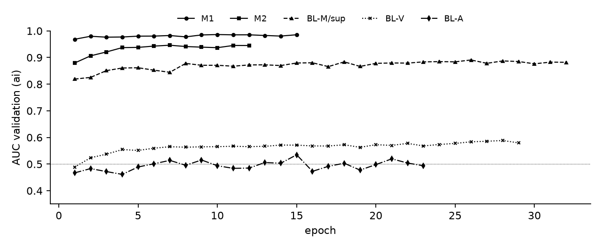
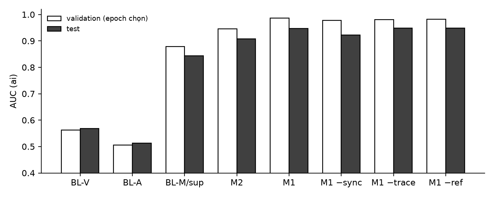
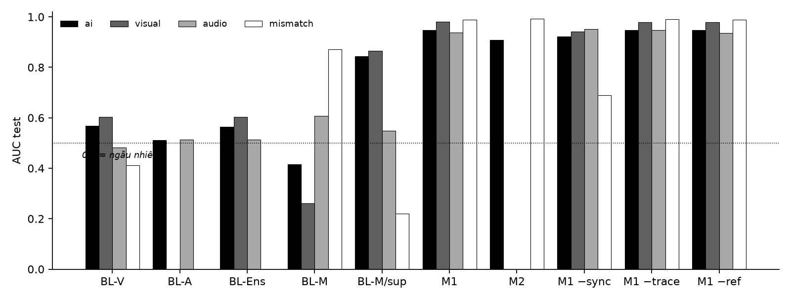
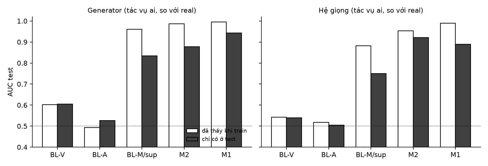
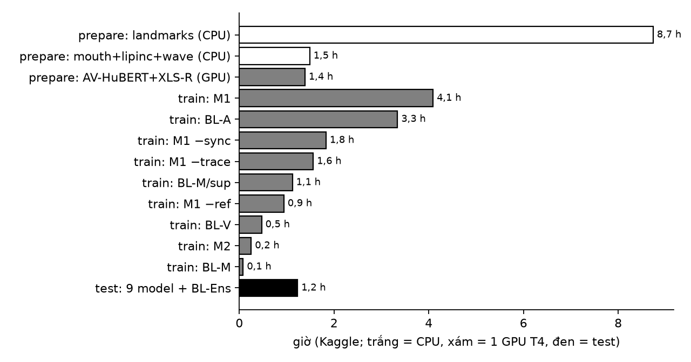

> Bản sao từ nhật ký nghiên cứu (`RESEARCH_WORKLOG/v003_model.md`, ngoài repo) ngày 26/10/2026. Sửa ở nhật ký rồi chép lại vào đây.

# v003 · Mô hình phát hiện: phương pháp, huấn luyện, kết quả part 1

Báo cáo nghiên cứu phần **mô hình phát hiện** của VN-AV-DF v003 (benchmark phát hiện lip-sync deepfake nghe-nhìn tiếng Việt). Cập nhật **26/10/2026** (test part 1 đã chạy một lần, 25-26/10).

File 3/3 của v003:
- [v003_data.md](v003_data.md): dữ liệu real.
- [v003_generation.md](v003_generation.md): sinh fake, bộ part 1.
- **v003_model.md** (file này): khảo sát phương pháp, lỗi của detector hiện nay, đội hình 4 baseline cài lại đúng code gốc + 2 model đề xuất + 3 ablation, protocol và cổng, huấn luyện, đánh giá, **kết quả part 1**, quá trình và lỗi.

Code: `vn-av-df-forensics/src/vn_av_df/training/` (prepare, data, models, train, lanes, evaluate, report), `features/`, `tracking.py`; notebook `notebooks/{prepare,train,demo}.ipynb` (sinh bằng `tools/make_notebooks.py`). Kết quả: `vn-av-df-forensics/runs/train_part1_v003/` (`report.md`, `evaluation.json`, `test-lock.json`, `gates.json`, mỗi model `history.json` / `metrics.json` / `predictions-*.npz`; log notebook ở `runs/kaggle_logs/`). Hình: `figures/v003/m*.png`.

---

## Cách đọc file này

**Bài toán.** Mỗi mẫu trả lời ba câu hỏi: **visual fake?** (hình bị AI vẽ), **audio fake?** (giọng AI), **AV mismatch?** (tiếng và môi lệch nhau), cộng điểm tổng **AI?** = max(visual, audio) và định vị đoạn giả. Sáu ô dữ liệu: v003_generation §3.1.

**Mức bằng chứng:** **●** đo trên dữ liệu của mình (part 1, 1 seed); **✔** đọc từ paper gốc / code gốc; **◐** chỉ abstract hoặc nguồn thứ cấp; **○** suy luận / ước lượng. Số của paper chỉ so trực tiếp khi cùng điều kiện. Kết quả v001 / v002 là bằng chứng phụ (test 2-3 người).

**Giai đoạn.** Part 1 là giai đoạn **đánh giá thiết kế**: 1 seed (42), 1 part (40 người, test 10 người). Kết luận ở đây là kết quả của part 1; con số cuối cùng sẽ là 3 seed trên nhiều part sau khi chốt thiết kế.

**Riêng tư.** Không nêu danh tính; hình chỉ là biểu đồ số liệu; W&B private, không đẩy media.

---

## Tóm tắt

Phát hiện lip-sync deepfake tiếng Việt cần trả lời riêng ba câu hỏi (hình giả, giọng giả, tiếng-môi lệch) vì bộ dữ liệu có cả **lệch tiếng thật không có AI** (ô ② sham). Chúng tôi cài lại **bốn baseline đúng code gốc** — BL-V (LIPINC-V2, chỉ hình), BL-A (XLS-R + AASIST, chỉ tiếng), BL-M (AVH-Align, chỉ học real) và BL-M/sup (cùng mạng, có giám sát) — cộng BL-Ens (gộp muộn BL-V, BL-A), và đề xuất **M1** (TriHead-v2: ba nhánh sync / trace / audio, ba đầu ra, tham chiếu người) và **M2** (AVH-Align+: cost volume theo độ trễ trên nền AVH-Align). Train trên part 1 (4.234 mẫu train), test **một lần** trên 2.336 mẫu của 10 người chưa thấy.

Kết quả test part 1 ● (AUC tác vụ AI?): **M1 0,947** · M2 0,908 · BL-M/sup 0,843 · BL-V 0,568 · BL-Ens 0,564 · BL-A 0,512 · BL-M 0,416. M1 hơn BL-M/sup **+0,104** [0,080; 0,125] và M2 hơn BL-M/sup **+0,065** [0,043; 0,085] (CI 95 % bootstrap theo người) — phép so công bằng nhất vì cùng dữ liệu và cùng đầu vào. Ablation: **nhánh sync là thứ phát hiện lệch tiếng-môi** (bỏ đi: mismatch 0,989 → 0,690), còn nhánh trace và tham chiếu người **không đóng góp đo được** trên part 1 (Δ ≤ 0,003). Detector chỉ đo độ khớp (BL-M) báo nhầm **98 %** clip sham; M1 gần như không (AUC sham-real 0,543). Phương pháp chưa thấy làm M1 giảm 0,995 → 0,942 (generator) và 0,990 → 0,889 (giọng); khó nhất LatentSync, VoxCPM2, F5 inpainting.

Giới hạn quan trọng: hai baseline đơn kênh **yếu bất thường** (BL-A không học được với công thức gốc trên dữ liệu nhỏ; BL-V gần ngẫu nhiên), nên các cổng "M1 hơn BL-Ens / BL-V / BL-A" (+0,35-0,38) **phóng đại** khoảng cách; 1 seed, 10 người test; định vị theo chuẩn AP còn rất thấp.

| Hạng mục | Giá trị | Mục |
|---|---|---|
| Đội hình | 4 baseline (đúng code gốc) + BL-Ens + M1 + M2 + 3 ablation M1 = 10 cấu hình, 9 lượt train | §3.1 |
| Dữ liệu | part 1 bản cắt 0,4 s: train 4.234 / validation 1.052 / test 2.336 (24 / 6 / 10 người) | §5.1 |
| Kết quả chính (AI?) | M1 0,947 · M2 0,908 · BL-M/sup 0,843 | §5.3 |
| Cổng công bằng | M1 − BL-M/sup +0,104; M2 − BL-M/sup +0,065 | §5.5 |
| Ablation | sync: mismatch +0,300; trace, ref: ~0 | §5.5 |
| Báo nhầm sham | BL-M 98 %; M1 ~ không (0,543) | §5.4 |
| Compute | prepare 11,6 giờ (CPU 10,2 + GPU 1,4) · train 13,7 giờ model · test 1,2 giờ | §5.8 |

---

# Chương 1. Giới thiệu

## 1.1. Bối cảnh

Lip-sync deepfake giữ nguyên gần như toàn bộ khung hình, chỉ vẽ lại miệng theo một đoạn tiếng mới; ghép với giọng nhân bản thì "đặt lời" được vào miệng người thật. Detector phải nhìn cả hình lẫn tiếng. Với tiếng Việt, thanh điệu gần như không thấy trên môi, nên lỗi của TTS chỉ bắt được qua tiếng, còn đồng bộ chủ yếu dựa vào nhịp đóng-mở miệng ○.

## 1.2. Khoảng trống: lỗi của detector hiện nay

| # | Lỗi | Bằng chứng | Phụ (v001 / v002) |
|---|---|---|---|
| X1 | Học thuộc dấu vết pixel của generator đã thấy | BioLip ✔: Xception 0,93 → 0,67 khi nén; LipFD chéo bộ 0,54 | W2L 0,98 → MuseTalk 0,55 ● |
| X2 | Lối tắt của dữ liệu | Smeu CVPR25 ✔: chỉ nhìn im lặng đầu clip > 98 %; Fake-or-JPEG ✔ | nhánh artifact báo nhầm 79-100 % clip chỉ bị xử lý ● |
| X3 | Phụ thuộc ngôn ngữ | PIA, TISAN chỉ chạy với phoneme tiếng Anh; AV-HuBERT pretrain tiếng Anh ✔ | - |
| X4 | Sụp khi nén | BioLip ✔: mọi phương pháp giảm 0,17-0,25 ở CRF40 | - |
| X5 | Generator làm mượt theo thời gian (IP-LAP, diffusion) | BioLip yếu nhất với IP-LAP ✔ | - |
| X6 | Gộp "lệch tiếng" vào "AI" | AVH-Align / SpeechForensics chỉ đo độ khớp ✔ | sync-only báo nhầm 88 % sham ● |
| X7 | Không định vị, hoặc định vị bằng vết nối | UMMAFormer LAV-DF → AV-1M 98,8 → 51,6 AP ✔ | - |
| X8 | Giọng giả không tổng quát sang TTS lạ | VietPrism ✔: VoxCPM2 EER 35 % | - |
| X9 | Điểm nền lệch theo người | POI-Forensics ✔ | AUC trong từng người 0,96, gộp 0,78 ● |
| X10 | Quá đắt | X-AVDT ~1 phút / clip ✔ | - |

## 1.3. Mục tiêu

1. Đội hình trả lời đủ ba câu hỏi, mỗi baseline **đúng code gốc** (tránh bị nói "cài sai baseline").
2. Một model trả lời cả ba câu hỏi, **tách lệch khỏi AI** (sham không bị báo nhầm).
3. Đánh giá đúng chuẩn: test một lần, người chưa thấy, phương pháp chưa thấy, CI theo người, điểm vận hành theo FPR, định vị.
4. Chạy được trên Kaggle (2×T4, 12 giờ / phiên), có bằng chứng tái lập.

## 1.4. Câu hỏi nghiên cứu (phần model)

| Mã | Câu hỏi | Trả lời ở |
|---|---|---|
| RQ-M1 | Một model ba đầu (M1) có phát hiện tốt hơn các baseline đúng gốc, và hơn gộp muộn hai chuyên gia đơn kênh? | §5.3, §5.5 |
| RQ-M2 | Tách đầu mismatch + học có sham có giảm báo nhầm "lệch thật = AI"? | §5.4 |
| RQ-M3 | Từng nhánh của M1 (sync, trace, tham chiếu) đóng góp gì? | §5.5 |
| RQ-M4 | Nâng AVH-Align bằng cost volume theo độ trễ (M2) có hơn bản gốc có giám sát trên cùng dữ liệu? | §5.5 |
| RQ-M5 | Model tổng quát thế nào sang người / generator / giọng chưa thấy? | §5.4 |
| RQ-M6 | Ở ngưỡng vận hành thực tế (FPR thấp), model dùng được tới đâu? Định vị được không? | §5.6, §5.7 |

## 1.5. Đóng góp (nói đúng mức)

- **Từng khối** của M1 / M2 đều đã có trong literature (§3.3.1). Cái mới là **cách ghép** và **bài toán**: tách ba câu hỏi với ② sham làm đối chứng, trên lip-sync tiếng Việt. Báo cáo dùng cụm "kiến trúc kết hợp, mỗi khối được kiểm bằng ablation", không nói "kiến trúc mới hoàn toàn".
- Bốn baseline cài lại theo code gốc, mọi khác biệt ghi rõ (§3.2).
- Đánh giá part 1 có cổng đặt trước, CI theo người, test khoá một lần.

---

# Chương 2. Tổng quan tài liệu

## 2.1. Toàn cảnh phương pháp

| Phương pháp | Năm · nơi | Ý chính | Train trên | Kết quả nổi bật (theo paper) | Code |
|---|---|---|---|---|---|
| **AVH-Align** | CVPR 2025 | AV-HuBERT → MLP chấm độ khớp từng frame; InfoNCE trên ±15 frame | **chỉ real** | bền với lối tắt im lặng; AUC FakeAVCeleb 94,6, AV-1M 85,9 (Bảng 2), test AV-1M chính thức 85,24 (Bảng 3) ✔ (đính chính 26/10: số 57,7 trước đây là của AVPF 2026, không phải paper này) | ✔ |
| SpeechForensics | NeurIPS 2024 | cosine AV-HuBERT, max theo độ lệch ±15 | không train | FF++ 97,6; FakeAVCeleb 99,0 | ✔ |
| BioLip / LADDER | arXiv 2026 | chỉ landmark môi, 4 bậc động học → CNN-1D 0,3 M | AVLips | LipSyncTIMIT zero-shot 0,925; 7 ngôn ngữ 0,85 | **không có** (kiểm 25/10) |
| **LIPINC-V2** | 2025 | bất nhất miệng theo thời gian, ViT + cross-attention | lip-sync | LipSyncTIMIT 0,96 (CRF23) / 0,76 (CRF40) | ✔ |
| LoCC | ICME 2026 | so frame với frame "phản thực" dự đoán | LAV-DF, AV-1M | hơn LIPINC theo paper | ✔ |
| PIA | arXiv 2025 | phoneme + viseme + ArcFace | FakeAVCeleb | 99,8 AUC; **chỉ tiếng Anh** | ✔ |
| LipFD | NeurIPS 2024 | phổ âm + frame miệng | AVLips | trong miền > 95 %; **chéo bộ ~0,54** | ✔ |
| X-AVDT | arXiv 2026 | đảo ngược diffusion | MMDF | chéo generator 95,3; **~1 phút / clip** | trang dự án |
| **XLS-R + AASIST** | Odyssey 2022 | SSL đa ngôn ngữ (có tiếng Việt) + graph attention | ASVspoof 2019 LA | **EER 0,82 % (LA 2021), 2,85 % (DF 2021)** ✔ | ✔ |
| POI-Forensics / Referee | 2023 / 2025 | so với video tham chiếu của chính người đó | chỉ real / có giám sát | bền chất lượng thấp; SOTA chéo bộ (Referee) | ✔ / chưa thấy |
| AV-LMMDetect / Omni-Fake | 2026 | MLLM fine-tune có giải thích | FakeAVCeleb, MAVOS-DD | 85,1 % open-set | một phần |

Lưu ý ✔: detector giọng train trên ASVspoof **giảm mạnh** trên dữ liệu ngoài đời (Müller et al., Interspeech 2022, "Does Audio Deepfake Detection Generalize?").

## 2.2. Cầu nối liên ngành

| Ý tưởng | Ngành gốc | Giải lỗi | Đã có cho deepfake? |
|---|---|---|---|
| Cost volume theo độ trễ + CNN 2D + soft-argmin | stereo (GC-Net, PSMNet), optical flow (RAFT) | X6, X7 | đặc trưng theo độ trễ: **có** (Feng et al. CVPR 2023 ✔); CNN 2D + soft-argmin có giám sát với đầu mismatch riêng: chưa tìm thấy |
| NPR ở độ phân giải gốc của miệng | image forensics (Tan et al. CVPR 2024) | X1, X4 | chưa tìm thấy cho vùng miệng |
| Residual "phản thực" theo thời gian | nội suy frame | X5, X7 | LoCC 2026 → không nhận mới |
| Động học landmark môi | biomechanics | X3, X4 | BioLip → dùng trong nhánh trace, không nhận mới |
| Chuẩn hoá theo người bằng clip tham chiếu | speaker verification | X9 | POI-Forensics, Referee ✔ → không nhận mới |
| Trộn lớp SSL có trọng số | ASR (SUPERB) | X8 | Lee et al. 2022 ✔ |
| Xoá thông tin người nói | domain adaptation (DANN; domain confusion) | X9 | Dao et al. 2026 ◐ |

---

# Chương 3. Thiết kế

## 3.1. Đội hình (chốt 23/10/2026)

Mỗi baseline trả lời một câu hỏi, vì sáu ô có giả hình, giả tiếng, giả cả hai và lệch tiếng thật.

| Mã | Model | Câu hỏi | Paper | Code gốc |
|---|---|---|---|---|
| BL-V | `lipinc_v2` · LIPINC-V2 | visual | Datta, Jia, Lyu, [arXiv 2504.01470](https://arxiv.org/abs/2504.01470) | [skrantidatta/LIPINC-V2](https://github.com/skrantidatta/LIPINC-V2) (Keras) |
| BL-A | `ssl_aasist` · XLS-R 300M + AASIST | audio | Tak et al., Odyssey 2022, [arXiv 2202.12233](https://arxiv.org/abs/2202.12233) | [TakHemlata/SSL_Anti-spoofing](https://github.com/TakHemlata/SSL_Anti-spoofing) (MIT) |
| BL-M | `avh_align` · AVH-Align | mismatch / AI | Smeu et al., CVPR 2025, [arXiv 2412.00175](https://arxiv.org/abs/2412.00175) | [bit-ml/AVH-Align](https://github.com/bit-ml/AVH-Align) |
| BL-M/sup | `avh_align_sup` · AVH-Align/sup | AI | cùng paper (baseline có giám sát do chính tác giả đặt) ✔ | như trên |
| BL-Ens | `bl_ens` = max(BL-V, BL-A) | AI | gộp muộn: Khalid et al., ADGD @ ACM MM 2021, [arXiv 2109.02993](https://arxiv.org/abs/2109.02993) ✔ | - |
| M1 | `trihead_v2` | cả 3 + AI | đề xuất | - |
| M2 | `avh_align_plus` | mismatch + AI | đề xuất | - |
| Ablation | `trihead_v2_no_sync` / `_no_trace` / `_no_ref` | | | |

Bỏ khỏi đội hình (23/10): BioLip (không có code gốc), AASIST-lite, AVCV, MTN (thành nhánh M1), 10 ablation cũ.

## 3.2. Baseline: cài lại và khác biệt với code gốc

Đã tải và đọc code gốc của cả ba repo (23/10) trước khi cài; khác biệt ghi ở đây và trong docstring (`training/models.py`).

**BL-M · AVH-Align** ✔:
- Φ = `FusionModel` gốc (chiếu hình / tiếng 1024 → 512, MLP 1024 → 512 → 256 → 128 → 1). Loss InfoNCE trên 31 độ trễ; điểm video log-sum-exp.
- Công thức gốc: Adam lr 1e-5, ReduceLROnPlateau, dừng sớm 10, tối đa 500 epoch.
- Khởi tạo từ checkpoint công bố `AVH-Align_AV1M.pt` (45 k video real AV-1M); đã kiểm: cho **điểm video giống hệt** `FusionModel` gốc (lệch < 3·10⁻⁶) ●. Khác: batch theo clip, loss trung bình, bỏ frame mất mặt.

**BL-M/sup · AVH-Align/sup** ✔: cùng Φ; cross-entropy trên (−s, s); Adam lr 1e-3, batch 1 video, 100 epoch, dừng sớm 10; khởi tạo ngẫu nhiên như gốc; nhãn AI?; thêm augment dịch tiếng −1…+2 (§4.2).

**BL-V · LIPINC-V2** ✔: tiền xử lý đúng `utils.py` gốc (căn mặt 256 px, crop môi 144 × 64, 5 frame có độ mở môi + 3 frame cùng tư thế, 7 ảnh hiệu); model đúng `model.py` (4,59 M tham số ●); loss CE + 5 × inconsistency (SSIM khả vi thay bản numpy không gradient của gốc); Adam lr 1e-3, epsilon 0,1, batch 64, 100 epoch. Khác: landmark từ cache AV-HuBERT; luật dự phòng khi không tìm được bộ frame (part 1: 1,2 % mẫu ●); ảnh chia 255; ảnh hiệu có dấu (gốc tràn uint8); nhãn = visual fake. Chỉ có điểm video.

**BL-A · XLS-R + AASIST** ✔:
- Back-end AASIST đúng `model.py` gốc; XLS-R 300M fine-tune toàn bộ; cửa sổ 64.600 mẫu, RawBoost algo 3, Adam lr 1e-6, weight decay 1e-4, batch 14, 100 epoch.
- **Lệch có lý do (25/10)**: trọng số lớp theo nguyên tắc của gốc, *trọng số lớp = 1 − tỉ lệ lớp trong train* (`class_weight: balanced`, mặc định; part 1 → 0,63 / 0,37). Con số 0,1 / 0,9 của gốc chính là nguyên tắc này trên ASVspoof 2019 LA (~90 % giả); giữ nguyên trên part 1 (37 % tiếng giả) thì lớp giả chỉ còn ~6 % tín hiệu. `class_weight: paper` giữ đúng 0,1 / 0,9.
- XLS-R + AASIST chạy cả batch một lượt như gốc (BatchNorm thống kê trên batch 14); bản cài đầu gọi từng mẫu — lỗi cài đặt, sửa 25/10 (§6.3).
- Khác: XLS-R qua `transformers`; khi chấm trượt cửa sổ 4 s bước 1 s, điểm video = max; AMP fp16; checkpoint chọn theo val loss.

**BL-Ens**: BL-V và BL-A chạy riêng, z-score theo real validation rồi lấy **max** (vì AI? = max(visual, audio); trung bình làm loãng ô chỉ giả một kênh).

**Encoder AV-HuBERT**: Large VoxCeleb2 + LRS3, fine-tune VSR, bản self-training `self_large_vox_433h` (đúng checkpoint AVH-Align dùng, commit `55401de`), lớp cuối.

## 3.3. Hai model đề xuất

### 3.3.1. Tính mới so với công trình gần nhất (rà 23/10)

| Khối | Gần nhất đã có | Phần của mình |
|---|---|---|
| Đặc trưng theo độ trễ (M1 sync, M2) | Feng et al. CVPR 2023 ✔; SpeechForensics | ma trận thời gian × độ trễ qua CNN 2D + soft-argmin, có giám sát; M2 dùng Φ đã pretrain của AVH-Align làm hàm chấm |
| Clip tham chiếu cùng người (M1) | POI-Forensics ✔, Referee ✔ | FiLM cho cả 3 đầu; ablation `no_ref` |
| Thay đoạn tiếng tạo mẫu giả | Astrid et al. ICASSP 2025 ✔ (gán fake) | gán **mismatch = 1, AI = 0** |
| Lệch tiếng thật như loại riêng | Deshmukh et al. 2026 ✔ | sham có cả lúc train và test, đầu mismatch riêng |
| NPR | Tan et al. CVPR 2024 ✔ | áp ở vùng miệng, độ phân giải gốc |
| Trộn nhóm lớp SSL | SUPERB ✔; Lee et al. 2022 ✔ | dùng nguyên |
| Xoá thông tin người nói | Ganin & Lempitsky 2015 ✔; Tzeng et al. 2015 ✔; Alvi et al. 2018 ✔ | biến thể entropy bị chặn (§3.3.2) là chi tiết cài đặt |

### 3.3.2. M1 · TriHead-v2 (`trihead_v2`, 1,94 M tham số)

```
nhánh sync  = cost volume ±15 (chiếu học được + cos) → CNN 2D → soft-argmin, đỉnh, entropy → TCN
nhánh trace = crop miệng 96×96 độ phân giải gốc → [ảnh, NPR, residual thời gian] → Conv3D ×3
              ‖ động học môi (y, vận tốc, gia tốc) + tư thế đầu (yaw / pitch / roll + vận tốc) → TCN
nhánh audio = XLS-R đóng băng, 3 nhóm lớp (1-4, 5-8, 9-12) trộn bằng softmax học được → 2 lớp attention
tham chiếu  = 3 clip real cùng người → FiLM  [h·(1+γ)+β ‖ h − ref]
đầu ra      : visual ← trace + sync · audio ← audio · mismatch ← sync + audio ; AI? = max(visual, audio)
```

Các thành phần: NPR đúng paper; luồng tư thế đầu (LipDA ◐); trọng số học được trên nhóm lớp XLS-R; gộp điểm top-5 frame; pseudo-fake thay đoạn tiếng (p = 0,25; nhãn mismatch = 1, AI = 0); **xoá thông tin người nói** ở nhánh audio và trace, λ tăng 0 → 0,3. Ban đầu dùng gradient reversal; **25/10 đổi** sang loss gây nhầm lẫn bị chặn: đầu người nói `LayerNorm → Linear` học nhận diện trên feature tách graph, phần mã hoá chịu λ·(ln K − entropy) qua đầu đó với trọng số đóng băng (giá trị trong [0, ln K]). Lý do đổi: §6.3 (GRL làm M1 vỡ ở epoch 3).

### 3.3.3. M2 · AVH-Align+ (`avh_align_plus`, 1,92 M tham số)

```
Φ = AlignMLP của AVH-Align, khởi tạo từ checkpoint công bố (học tiếp với lr 1e-5)
cost volume C[t, δ] = Φ(v_t, a_t+δ), δ ∈ [−15, 15] ‖ kênh vị trí δ/15 → CNN 2D → soft-argmin, đỉnh, entropy
‖ vận tốc môi + tư thế đầu → TCN → 2 đầu: ai, mismatch ; pseudo-fake thay đoạn tiếng (p = 0,25)
```

Học có giám sát trên **cùng dữ liệu** với BL-M/sup → phép so sạch nhất (cùng nền Φ).

| Mã | Cấu hình | Tham số học ● |
|---|---|---|
| BL-V | `lipinc_v2` | 4,59 M |
| BL-A | `ssl_aasist` | 0,45 M + XLS-R 315 M |
| BL-M | `avh_align`, `avh_align_sup` | 1,74 M |
| M1 | `trihead_v2` · `_no_sync` · `_no_trace` · `_no_ref` | 1,94 M · 0,87 M · 1,58 M · 1,76 M |
| M2 | `avh_align_plus` | 1,92 M |

## 3.4. Protocol và cổng

- Nhánh đánh giá: generator / giọng đã thấy và chưa thấy, người chưa thấy, định vị, lệch tiếng.
- AUC là chỉ số chính, chấm riêng bốn tác vụ; model một điểm dùng cùng điểm cho mọi tác vụ (để thấy nó thực ra bắt cái gì).
- **Cổng đặt trước** (23/10), ΔAUC kèm CI bootstrap theo người (`report.GATES`):

| # | So sánh | Tác vụ |
|---|---|---|
| 1 | M1 − BL-Ens | AI? |
| 2 | M1 − BL-V | visual |
| 3 | M1 − BL-A | audio |
| 4 | M1 − BL-M/sup, M1 − BL-M | mismatch |
| 5 | M1 − M1 no_ref (≥ 0,03) | AI? |
| 6 | M1 − M1 no_sync (mismatch); M1 − M1 no_trace (visual) | |
| 7 | M2 − BL-M/sup, M2 − BL-M | mismatch |

Báo nhầm trên sham báo riêng. Không đổi cổng sau khi xem test; phép so bổ sung sau test ghi rõ là bổ sung (§5.5).

---

# Chương 4. Pipeline và phương pháp

## 4.1. Trích đặc trưng (prepare)

| Encoder | Nội dung | Máy | Thời gian part 1 ● |
|---|---|---|---|
| `landmarks` | dlib 68 điểm, hộp miệng, mặt nạ hợp lệ | Kaggle CPU 4 nhân | 8,74 giờ |
| `mouth` | crop miệng 96×96 độ phân giải gốc + tư thế đầu | CPU | 0,77 giờ |
| `lipinc` | 8 crop LIPINC-V2 | CPU | 0,54 giờ |
| `wave` | tiếng 16 kHz | CPU | 0,17 giờ |
| `avhubert` | AV-HuBERT Large 25 Hz (đọc landmark có sẵn) | T4 × 2 | 1,21 giờ |
| `xlsr` | XLS-R 300M, 3 nhóm lớp | T4 × 2 | 0,17 giờ |

Mỗi part **ba phiên Kaggle**: `landmarks` (CPU, không tốn quota GPU) → song song `cpu` (mouth, lipinc, wave) và `gpu` (avhubert, xlsr). Lý do: đo trên part 1, dlib dò mặt chiếm 86 % thời gian của bước AV-HuBERT (7,1 / 8,3 s mỗi mẫu) ●, nên phiên một-stage cũ ~9 giờ GPU gần như chỉ chờ CPU; hai stage cho kết quả trùng từng giá trị (test). Kiểm chất lượng ●: 98,0 % frame có mặt hợp lệ; 118 / 7.622 clip (1,5 %) dưới 50 % frame hợp lệ; AV-HuBERT kiểm chéo độ lệch tiếng-hình trên 792 clip real: 86,5 % trong ±1 frame, trung vị −1 frame (khớp bước sửa SyncNet ở v003_data §4.3).

## 4.2. Huấn luyện

| Hạng mục | Giá trị |
|---|---|
| Nhãn | theo frame (0,04 s) cho mọi đầu ra |
| Cân lớp | `pos_weights` = số nhãn 0 / số nhãn 1 (kẹp 0,2-5), trừ baseline có công thức riêng |
| Công thức | baseline: đúng code gốc (§3.2); M1, M2: AdamW lr 3e-4, wd 1e-4, batch 16, ≤ 30 epoch, dừng sớm 5 (M2: Φ lr 1e-5) |
| Cân theo người | lấy mẫu train theo 1 / số clip của người đó |
| Validation | AUC 4 tác vụ mỗi epoch; checkpoint chọn theo val loss |
| Augment lệch tiếng | trượt tiếng so với hình k ∈ [−1, +2] frame khi nạp, nhãn giữ nguyên; mọi model có giám sát dùng cả hai phía, trừ BL-M |
| Hai GPU | `LANES`: mỗi GPU một tiến trình train một nhóm model, gộp kết quả bằng chuyển file (`training/lanes.py`) |
| Giới hạn phiên | `MAX_HOURS` 11: dừng sạch sau epoch, phiên sau train tiếp từ `last.pt` |
| Tái lập | `last.pt` gồm optimizer, scheduler, AMP scaler, trạng thái ngẫu nhiên; đổi cấu hình giữa chừng thì báo lỗi |
| Nguồn gốc | `provenance.json` (dữ liệu, chữ ký cache, commit, môi trường), `hyperparameter_search: null` |

## 4.3. Đánh giá

- 4 tác vụ, **AUC chính**, kèm AP, EER, F1; **AUC cân theo người**; phân rã theo ô, generator, giọng, full / partial, đã thấy / chưa thấy, giới; AUC trong từng người.
- **Tham chiếu cố định khi chấm**: 3 clip real đầu theo `sample_id` của cùng người, **trừ clip gốc của chính mẫu** (sửa 25/10 trước khi test, §6.3).
- **Ref-norm**: chuẩn hoá điểm theo clip tham chiếu, bỏ clip tham chiếu và mọi file sinh từ chúng.
- **Điểm vận hành** (Layton et al. ✔): ngưỡng = FPR 1 % / 5 % trên real validation; báo TPR, FPR thật ở test, precision khi fake chiếm 50 / 10 / 1 %; FPR riêng real và sham.
- **Định vị**: trong clip (ô điểm cao nhất có nằm trong đoạn; AUC ô trong / ngoài đoạn) và chuẩn LAV-DF / AV-1M (AP@IoU 0,5 / 0,75 / 0,95, AR@1/5/10).
- **Test một lần**, khoá bằng `test-lock.json` (chữ ký dữ liệu + sha256 mọi checkpoint).

## 4.4. Log W&B và bằng chứng

Chỉ cho prepare / train / evaluate / report; project private; không media. Mỗi epoch: loss tổng và từng đầu, grad norm, lr, AUC validation 4 tác vụ và theo ô / generator / giọng; lúc kết thúc: epoch tốt nhất, lý do dừng, `best.pt` + `history.json`. **Bằng chứng nằm ở file local**, W&B là bản sao (W&B lỗi thì chỉ cảnh báo). Đối chiếu checklist NeurIPS (mục 6-8), ML Reproducibility Checklist v2.0, Model Cards: môi trường, dữ liệu bị xử lý khác luật gốc (tỉ lệ dự phòng LIPINC), cách chọn siêu tham số, nguồn biến động của CI, phân rã theo giới, compute kể cả phiên hỏng (§6.2).

## 4.5. Demo

Kaggle + Gradio, 2 tab: tạo fake từ video real (dùng đúng hàm của pipeline sinh) và phân tích (sửa độ lệch bằng SyncNet → đặc trưng → điểm 4 tác vụ theo ngưỡng FPR 5 %, timeline). Giới hạn 60 s; link `gradio.live` công khai trong lúc chạy.

## 4.6. Kiểm thử

115 test trên dữ liệu tổng hợp (26/10 ●): forward / backward mọi cấu hình, train → test → BL-Ens → report end-to-end, train tiếp sau ngắt, `MAX_HOURS`, hai GPU (tiến trình thật), rò bộ nhớ và gom batch của BL-A, loss gây nhầm lẫn bị chặn, tham chiếu không chứa clip gốc, AVH-Align nạp checkpoint công bố cho điểm giống hệt gốc.

---

# Chương 5. Kết quả part 1

## 5.1. Thiết lập

- Dữ liệu: part 1 bản cắt 0,4 s (v003_generation §4.5): train 4.234 / validation 1.052 / test 2.336 mẫu; 24 / 6 / 10 người; test gồm 2 generator và 3 hệ giọng chưa thấy.
- 1 seed (42); BL-M chỉ học 480 clip real train (validation 120 clip real).
- Test chạy một lần 25-26/10 trên Kaggle (73,8 phút cho 9 model + BL-Ens); `report.md` dựng lại trên máy từ các file kết quả vì bước tải lên W&B lỗi sau khi đã ghi xong (§6.3).

## 5.2. M00 · Diễn biến huấn luyện

| Model | Epoch chạy | Epoch chọn | Dừng | Phút / epoch | Giờ train | Val AUC (AI?) tại epoch chọn |
|---|---|---|---|---|---|---|
| BL-V | 29 | 19 | dừng sớm (10) | 1,0 | 0,47 | 0,563 |
| BL-A | 23 | 13 | dừng sớm (10) | 8,7 | 3,34 | 0,506 |
| BL-M | 27 | 17 | dừng sớm (10) | 0,2 | 0,08 | - (val chỉ có real) |
| BL-M/sup | 32 | 22 | dừng sớm (10) | 2,1 | 1,12 | 0,879 |
| **M1** | 15 | 10 | dừng sớm (5) | 16,4 | 4,09 | **0,986** |
| M2 | 12 | 7 | dừng sớm (5) | 1,2 | 0,25 | 0,946 |
| M1 −sync | 10 | 5 | dừng sớm (5) | 11,0 | 1,83 | 0,977 |
| M1 −trace | 12 | 7 | dừng sớm (5) | 7,8 | 1,56 | 0,980 |
| M1 −ref | 13 | 8 | dừng sớm (5) | 4,4 | 0,94 | 0,982 |



- Mọi model dừng sớm đúng cách; không model nào chạm `MAX_HOURS`.
- **M1 ổn định sau khi đổi loss người nói**: loss gây nhầm lẫn ~0,01-0,04, CE người nói ~3,1 (gần ln 28 = 3,33), grad norm ~10-15 (bản GRL: 900 ở epoch 3).
- **BL-A không học**: val AUC dao động 0,46-0,54 suốt 23 epoch ở **mọi ô**, cả với trọng số `balanced`.
- **BL-M** checkpoint công bố đã được nạp: val loss epoch 1 là 1,60, thấp hơn hẳn mức ngẫu nhiên ln 31 = 3,43; val loss tốt nhất ở epoch 17 rồi tăng (khớp quá 480 clip real).



**Val → test**: M1 0,986 → 0,947; ablation 0,977-0,982 → 0,922-0,949; BL-M/sup 0,879 → 0,843. Mức giảm ~0,04 đến từ người và phương pháp chưa thấy ở test (validation chỉ có phương pháp đã thấy).

## 5.3. M01 · Kết quả chính trên test



| Model | AI? | visual | audio | mismatch | EER (AI?) | AP (AI?) | AUC trong từng người: TB / thấp nhất |
|---|---|---|---|---|---|---|---|
| BL-V | 0,568 | 0,603 | 0,482 | 0,412 | 0,451 | - | - / 0,536 |
| BL-A | 0,512 | - | 0,514 | - | 0,490 | - | - / 0,438 |
| BL-Ens | 0,564 | 0,603 | 0,514 | - | 0,453 | - | - / 0,534 |
| BL-M | 0,416 | 0,261 | 0,608 | 0,871 | 0,592 | - | - / 0,383 |
| BL-M/sup | 0,843 | 0,865 | 0,548 | 0,221 | 0,245 | - | - / 0,806 |
| **M1** | **0,947** | **0,981** | 0,938 | 0,989 | **0,108** | 0,984 | 0,951 / 0,904 |
| M2 | 0,908 | - | - | **0,992** | 0,158 | - | - / 0,878 |
| M1 −sync | 0,922 | 0,942 | **0,951** | 0,690 | 0,139 | - | - / 0,887 |
| M1 −trace | 0,948 | 0,978 | 0,947 | 0,991 | 0,114 | - | - / 0,921 |
| M1 −ref | **0,949** | 0,979 | 0,937 | 0,988 | 0,122 | - | - / 0,919 |

- AUC cân theo người gần như bằng AUC gộp (mỗi người cùng số clip).
- **Đọc đúng BL-M**: AUC AI? 0,416 *dưới* 0,5 không phải vì không bắt được giả — so từng ô giả với real nó đạt 0,77-0,96 — mà vì nó chấm ② sham (nhãn AI = 0) **giả hơn cả fake** (§5.4). Đây là lỗi X6 hiện ra trên số.
- BL-M/sup: mismatch 0,221 (dưới 0,5) vì một điểm AI? dùng cho tác vụ mismatch: nó chấm sham thấp (đúng với AI = 0) nhưng sham lại có nhãn mismatch = 1.

## 5.4. M02 · Phân rã: sham, chưa thấy, theo ô, theo giới

**Báo nhầm sham** (AUC sham so với real trên điểm AI?; 0,5 = không nhầm):

| BL-M | M2 | M1 −ref | BL-M/sup | M1 −sync | M1 | M1 −trace | BL-V | BL-A |
|---|---|---|---|---|---|---|---|---|
| **0,981** | 0,792 | 0,583 | 0,527 | 0,549 | **0,543** | 0,535 | 0,500 | 0,491 |


Ở ngưỡng F1 tốt nhất chọn trên validation, M1 báo nhầm 9,5 % real và 13,1 % sham ở test; ở ngưỡng FPR 5 % (mẫu nhãn 0 của validation, §5.6) là 7,0 % real và 10,7 % sham (đính chính 26/10: bản trước ghi nhầm tên ngưỡng).

**Đã thấy / chưa thấy** (tác vụ AI?, mỗi nhóm so với real):



| Model | Generator đã thấy | chưa thấy | Giọng đã thấy | chưa thấy |
|---|---|---|---|---|
| **M1** | 0,995 | **0,942** | 0,990 | **0,889** |
| M2 | 0,986 | 0,878 | 0,953 | 0,921 |
| BL-M/sup | 0,961 | 0,834 | 0,883 | 0,750 |
| BL-V | 0,602 | 0,604 | 0,542 | 0,539 |
| BL-A | 0,493 | 0,527 | 0,518 | 0,504 |

Theo từng phương pháp: v003_generation §5.6 (khó nhất LatentSync 0,902; VoxCPM2 0,848; F5 inpainting 0,856 với M1). M2 tổng quát sang **giọng** lạ tốt hơn M1 (0,921 so với 0,889) ○ — M2 không có nhánh nghe giọng nên dựa hẳn vào độ khớp tiếng-môi, ít phụ thuộc dấu vết của hệ TTS.

**Theo ô** (M1, AI?): ⑥ both 0,997 · ⑤ donor 0,990 · ④ source 0,946 · ③ voice 0,909; full 0,971 · partial 0,941. **Theo giới** (M1): nữ 0,964 · nam 0,945.

## 5.5. M03 · Cổng và ablation

Cổng đặt trước (bootstrap theo người, 10 người, 1.000 lần):

| # | So sánh | Tác vụ | ΔAUC | CI 95 % | Đạt? |
|---|---|---|---|---|---|
| 1 | M1 − BL-Ens | AI? | +0,383 | [+0,347; +0,410] | đạt (⚠ baseline yếu) |
| 2 | M1 − BL-V (generator chưa thấy) | visual | +0,348 | [+0,306; +0,376] | đạt (⚠) |
| 3 | M1 − BL-A (giọng chưa thấy) | audio | +0,381 | [+0,349; +0,422] | đạt (⚠ BL-A không học) |
| 4a | M1 − BL-M/sup | mismatch | +0,769 | [+0,751; +0,786] | đạt (⚠ BL-M/sup không có đầu mismatch) |
| 4b | M1 − BL-M | mismatch | +0,118 | [+0,100; +0,133] | đạt |
| 5 | M1 − M1 no_ref (≥ 0,03) | AI? | −0,001 | [−0,011; +0,009] | **trượt** |
| 6a | M1 − M1 no_sync | mismatch | +0,300 | [+0,287; +0,311] | đạt |
| 6b | M1 − M1 no_trace | visual | +0,003 | [−0,004; +0,008] | **trượt** (CI chứa 0) |
| 7a | M2 − BL-M/sup | mismatch | +0,771 | [+0,753; +0,790] | đạt (⚠ như 4a) |
| 7b | M2 − BL-M | mismatch | +0,121 | [+0,105; +0,135] | đạt |

So sánh bổ sung sau test (cùng cách bootstrap; không phải cổng đặt trước):

| So sánh | Tác vụ | ΔAUC | CI 95 % |
|---|---|---|---|
| M2 − BL-M/sup (cùng dữ liệu, cùng đầu vào) | AI? | **+0,065** | [+0,043; +0,085] |
| M1 − BL-M/sup | AI? | **+0,104** | [+0,080; +0,125] |
| M1 − M2 | AI? | +0,039 | [+0,017; +0,062] |

- **Đóng góp được chứng minh**: nhánh sync (mismatch +0,300); M2 hơn BL-M/sup và BL-M; M1 hơn BL-M/sup và M2 trên AI?.
- **Không chứng minh được**: tham chiếu người (cổng 5 trượt) và nhánh trace (cổng 6b trượt). Theo quy ước đặt trước, hai nhánh này **không được nhận là đóng góp** ở part 1.
- **Cổng 1-3 đạt nhưng không có giá trị chứng minh**: baseline đơn kênh gần ngẫu nhiên (§7.2).

## 5.6. M04 · Điểm vận hành

Ngưỡng chọn trên real validation, áp vào test (tác vụ AI?):

| Model | Ngưỡng FPR 1 %: TPR / FPR thật | Ngưỡng FPR 5 %: TPR / FPR thật | Precision ở π = 10 % (FPR 5 %) | Báo nhầm / 1.000 real |
|---|---|---|---|---|
| **M1** | **0,789** / 0,029 | 0,876 / 0,095 | 0,507 | 95 |
| M1 −trace | 0,747 / 0,031 | 0,831 / 0,067 | 0,580 | 67 |
| M1 −ref | 0,761 / 0,014 | 0,864 / 0,108 | 0,470 | 108 |
| M2 | 0,534 / 0,009 | 0,696 / 0,034 | 0,692 | 34 |
| BL-M/sup | 0,472 / 0,010 | 0,596 / 0,046 | 0,588 | 46 |
| BL-V | 0,248 / 0,179 | 0,343 / 0,277 | 0,121 | 277 |
| BL-A | 0,011 / 0,017 | 0,069 / 0,060 | 0,113 | 60 |

- **Ngưỡng trôi giữa validation và test**: với M1, đặt FPR 1 % trên validation thì ở test thành 2,9 %; đặt 5 % thành 9,5 % — người test khác người validation (6 người) nên phân bố điểm real lệch. Với 200 real test, mỗi báo nhầm = 0,5 %.
- Ở FPR ~3 %, M1 vẫn bắt 79 % fake; khi fake chỉ chiếm 10 % ngoài thực tế, precision ~0,5 → cần hiệu chuẩn ngưỡng theo người / theo ngữ cảnh trước khi dùng thật.

## 5.7. M05 · Định vị đoạn giả

| Model | Trong clip: AUC ô trong / ngoài đoạn | Ô điểm cao nhất nằm trong đoạn | AP@0,5 | AR@10 |
|---|---|---|---|---|
| **M1 −ref** | **0,944** | 0,912 | 0,017 | 0,277 |
| M1 | 0,932 | 0,898 | 0,017 | 0,276 |
| M1 −trace | 0,936 | **0,924** | 0,019 | 0,284 |
| M2 | 0,927 | 0,882 | 0,021 | 0,276 |
| BL-M | 0,832 | 0,853 | 0,004 | 0,122 |
| BL-M/sup | 0,648 | 0,729 | 0,001 | 0,026 |
| BL-A | 0,564 | 0,075 | 0,278 ⚠ | 0,348 ⚠ |

- **Trong clip, M1 / M2 định vị tốt** (AUC ô trong / ngoài 0,93; ~90 % clip partial có ô cao nhất nằm trong đoạn giả).
- **Theo chuẩn AP thì rất thấp** (AP@0,5 ≈ 0,02): cách tạo đoạn ứng viên (cắt ngưỡng điểm theo frame + NMS, §4.3) chưa tạo được đoạn khớp ranh giới; đây là điểm yếu của bước hậu xử lý hơn là của điểm frame ○.
- ⚠ AP / AR của BL-A cao giả tạo: điểm cửa sổ 4 s của BL-A gần như hằng trong clip nên đoạn ứng viên phủ cả clip, trùng với file giả **full** (đoạn giả = cả clip); "ô cao nhất trong đoạn" chỉ 0,075 cho thấy nó không định vị được.

## 5.8. M06 · Compute



| Bước | Giờ ● | Máy |
|---|---|---|
| Prepare: landmarks | 8,74 | Kaggle CPU 4 nhân |
| Prepare: mouth + lipinc + wave | 1,48 | Kaggle CPU |
| Prepare: AV-HuBERT + XLS-R | 1,38 | Kaggle T4 × 2 |
| Train 9 model (thời gian model, 2 GPU song song) | 13,7 (M1 4,1 · BL-A 3,3 · ablation 4,3 · còn lại 1,9) | Kaggle T4 |
| Test 9 model + BL-Ens | 1,23 | Kaggle T4 × 2 |

Hai notebook train chạy song song, mỗi notebook 2 GPU; tổng giờ phiên train ≈ 8-9 giờ ○ (log notebook ở `runs/kaggle_logs/`). Phiên hỏng: §6.2.

## 5.9. Trả lời câu hỏi nghiên cứu

| Mã | Trả lời |
|---|---|
| RQ-M1 | M1 tốt nhất (AI? 0,947); hơn BL-M/sup +0,104 và M2 +0,039 với CI không chứa 0. Hơn BL-Ens +0,383 nhưng BL-Ens yếu bất thường nên chưa trả lời được câu "gộp trong một model có hơn gộp muộn hai chuyên gia **tốt**" |
| RQ-M2 | Có: M1 (học có sham, đầu mismatch riêng) gần như không nhầm sham (0,543) trong khi BL-M nhầm 98 %; M2 (đầu mismatch, không có nhánh nghe giọng) vẫn nhầm 0,792 |
| RQ-M3 | Nhánh sync quyết định tác vụ mismatch (+0,300); trace và tham chiếu không đóng góp đo được trên part 1 |
| RQ-M4 | Có: M2 hơn BL-M/sup +0,065 (AI?) trên cùng dữ liệu và đầu vào |
| RQ-M5 | Người chưa thấy: AUC trong từng người ≥ 0,904 (M1). Generator chưa thấy −0,053, giọng chưa thấy −0,101 (M1); khó nhất LatentSync, VoxCPM2, F5 inpainting |
| RQ-M6 | Ở FPR thật ~3 %, M1 bắt 79 % fake; ngưỡng trôi ~2× giữa validation và test; định vị trong clip tốt nhưng AP chuẩn rất thấp |

---

# Chương 6. Quá trình thực hiện, lỗi và thay đổi

## 6.1. Dòng thời gian

| Ngày (2026) | Việc |
|---|---|
| 15/10 | Khảo sát phương pháp, đội hình đầu (6 baseline + 3 đề xuất) |
| 22/10 | Research kiến trúc theo lớp (board `slides/v003/model_board.html`) |
| 23/10 | Chốt đội hình 9 cấu hình; cài 4 baseline đúng code gốc; prepare lần 1-4 hỏng (W&B, checkpoint, kiểm tra kích thước) |
| 24/10 | Prepare lần 5 (một stage, ~9 h) → tách stage landmarks CPU / model GPU → ba phiên |
| 25/10 | Train: 3 lần hỏng (NaN grad, rò bộ nhớ BL-A, đọc cache chậm) → 2 GPU song song; M1 vỡ do GRL → loss gây nhầm lẫn; BL-A `balanced`; hai notebook `-ta` / `-tb`; sửa rò tham chiếu |
| 25-26/10 | Test một lần (`-ta-2`); dựng `report.md` trên máy |

## 6.2. Nhật ký compute (kể cả phiên hỏng)

Giờ phiên là thời gian chạy của phiên Kaggle.

| Ngày | Việc | Máy | Giờ phiên | Kết quả |
|---|---|---|---|---|
| 23/10 | Prepare P1 lần 1-2 | T4 × 2 | 0,3 | **hỏng**: W&B từ chối key / ghi vào team không có quyền |
| 23/10 | Prepare P1 lần 3 | T4 × 2 | ~0,3 | **hỏng**: thiếu `import hubert_asr`, checkpoint nhầm `large_vox_433h` |
| 23-24/10 | Prepare P1 lần 4 | T4 × 2 | ~0,3 | **hỏng**: kiểm `stack_order_audio` từ task VSR thay vì encoder |
| 24/10 | Prepare P1 lần 5 (một stage) | T4 × 2 | ~9 | **dừng ở 7.592 / 7.622**: rò RAM worker ~6 GB / giờ, worker bị giết |
| 24/10 | Prepare P1 lần 6 (CPU, 4 encoder) | CPU | ~0,8 | **dừng chủ động**: ~13 mẫu / phút, cả phiên sẽ vượt 12 giờ → tách 3 phiên |
| 24-25/10 | Prepare P1 · landmarks / cpu / gpu | CPU / CPU / T4 × 2 | 8,7 / ~1,5 / ~1,4 | **xong** |
| 25/10 | Train T-A lần 1 (BL-A) | T4 | ~0,26 | **hỏng**: grad norm NaN (AMP) ghi JSON lỗi |
| 25/10 | Train T-A lần 2 (BL-A) | T4 | ~0,5 | **hỏng**: CUDA hết bộ nhớ (rò ~16 MB / bước) |
| 25/10 | Train T-B lần 1 | T4 | ~0,3 | **dừng tay**: đọc ~30 nghìn file chữ ký tuần tự, > 17 phút không in gì |
| 25/10 | Train phiên lane đầu (1 notebook, 2 GPU) | T4 × 2 | ~1,4 | **dừng chủ động**: M1 vỡ ở epoch 3 (GRL), BL-A ~0,5 |
| 25/10 | Train `-ta` (BL-A, M1, M2, BL-V) | T4 × 2 | ~5 ○ | **xong** |
| 25/10 | Train `-tb` (BL-M, BL-M/sup, 3 ablation) | T4 × 2 | ~3 ○ | **xong** |
| 25-26/10 | `-ta-2`: gộp + test | T4 × 2 | ~1,5 ○ | **test xong**, lỗi ở bước tải artifact W&B (sau khi đã ghi kết quả) |
| 26/10 | Dựng `report.md` + phân tích | Local CPU | < 0,2 | xong |

Phần sinh fake (54,6 giờ phiên): v003_generation §5.4.

## 6.3. Lỗi và bài học

| Lỗi | Phát hiện | Sửa / bài học |
|---|---|---|
| Thiếu `import hubert_asr`, checkpoint nhầm | prepare lần 3 | đối chiếu code AVH-Align commit `55401de` |
| Kiểm kích thước tiếng sai chỗ | prepare lần 4 | kiểm theo `feature_extractor_audio.proj.in_features` (104) |
| Rò RAM trong worker AV-HuBERT; một mẫu lỗi bỏ cả nhóm clip | prepare lần 5 | mở lại worker sau 300 mẫu; mẫu lỗi thử lại ở cuối |
| dlib dò mặt là 86 % thời gian, GPU ngồi chờ | đo 24/10 | tách stage landmarks chạy CPU |
| Grad norm NaN do AMP làm hỏng ghi JSON | T-A lần 1 | chỉ lấy norm hữu hạn, đếm bước tràn |
| **Rò bộ nhớ ~16 MB / bước ở BL-A**: điểm frame ghi đè bằng `max` vào tensor còn gắn graph không bao giờ backward → vòng tham chiếu autograd | T-A lần 2; tái hiện trên máy local | `detach` điểm frame; test |
| **BL-A gọi XLS-R + AASIST từng mẫu (batch 1)**: BatchNorm của AASIST chỉ thống kê trên 1 mẫu, khác gốc | đọc code khi sửa rò | gom cả batch một lượt (đúng gốc); khi chấm trùng cách cũ (test) |
| Đọc chữ ký cache tuần tự rất chậm | T-B lần 1 | đọc song song 16 luồng + in tiến độ |
| **GRL làm M1 vỡ**: CE người nói nhánh trace 10,5 → 28, grad norm 900 bị cắt về 5 nên tác vụ chính gần như không học; val loss 1,63 → 11,1 | số liệu W&B tải về | loss gây nhầm lẫn bị chặn + LayerNorm; sau sửa CE người nói ~3,1, grad ~10-15 |
| Trọng số lớp 0,1 / 0,9 lệch trên dữ liệu 37 % giả | BL-A AUC ~0,5 | `class_weight: balanced` — **không đủ**: BL-A vẫn ~0,5 |
| **Rò tham chiếu ở val / test**: tham chiếu cố định không bỏ clip gốc của chính mẫu → 15 % mẫu được so với chính bản gốc | đọc code khi xét số cao | bỏ clip gốc (sửa trước khi test, không train lại vì `no_ref` ≈ M1 trên val) |
| Tải artifact W&B lỗi trùng tên `metrics.json` | `-ta-2` | đặt file trùng tên dưới thư mục model; bản W&B giả trong test cũng báo lỗi như thật |
| Test sớm khi một notebook mới có 4 / 10 model | rà trước khi chạy | cổng test luôn kiểm đủ 10 model |

## 6.4. Nhật ký câu hỏi và quyết định

| Ngày | Câu hỏi / việc | Trả lời / quyết định |
|---|---|---|
| 15/10 | Chọn baseline, kiến trúc | đội hình đầu; thay 23/10 |
| 17/10 | Augment lệch tiếng tạo clip mới? | không; trượt chuỗi đặc trưng khi nạp |
| 18/10 | W&B ghi gì | chỉ train (có prepare), không media |
| 18/10 | Tỉ lệ fake / real | không đổi dữ liệu; ngưỡng theo FPR, báo nhiều base-rate |
| 23/10 | Quá nhiều model | 3 baseline chuyên trách + BL-Ens + M1 + M2 |
| 23/10 | BL-M chỉ học real? | chạy cả hai bản (`avh_align`, `avh_align_sup`) |
| 23/10 | Part 1 bao nhiêu seed? | **1 seed (42)**; 3 seed sau khi chốt |
| 23/10 | Tính mới, link paper | rà lại, thêm §3.3.1, kiểm mã arXiv |
| 24/10 | Tách prepare CPU / GPU | ba phiên |
| 25/10 | Tối ưu bộ nhớ, dùng 2 GPU | sửa rò + gom batch; 2 lane song song |
| 25/10 | GRL vỡ: giảm λ hay đổi loss? | đổi sang loss gây nhầm lẫn bị chặn (user duyệt) |
| 25/10 | BL-A: 0,1 / 0,9 hay theo tỉ lệ dữ liệu? | `balanced` mặc định (user duyệt) |
| 25/10 | Chia mấy notebook | `-ta` / `-tb`, test ở phiên gộp `-ta-2` |
| 25/10 | Số cao có phải overfit? | không theo nghĩa thông thường; phát hiện rò tham chiếu → sửa phần chấm trước khi test |
| 25/10 | Có thêm BioLip làm baseline? | không (không có code gốc); thêm test độ bền nén vào việc mở |
| 26/10 | Test trước, sửa sau | chạy test với đội hình hiện có; thay đổi model để sau (cuối file) |

## 6.5. Những điều đã đính chính

| Đã nói | Đúng là |
|---|---|
| "Train loss BL-A > ln 2 nghĩa là không khớp nổi tập train" | quá mạnh: AASIST có dropout 0,5 khi train nên train loss luôn cao hơn val |
| "Trọng số lớp là nguyên nhân chính khiến BL-A không học" | đổi sang `balanced` vẫn ~0,5; nguyên nhân chưa xác định (§7.2) |
| "T-B bị treo" | đang đọc file rất chậm, không phải treo |
| "Phiên một-stage cũ 17-18 mẫu / phút" | đó là lúc đầu; trung bình cả phiên ~14 |
| "Ít nhất 9 cổng sẽ cho kết luận rõ" | cổng 1-3 đạt nhưng không có giá trị chứng minh vì baseline yếu |

---

# Chương 7. Thảo luận

## 7.1. M1 mạnh ở đâu, các nhánh có cần không

- M1 tốt nhất trên mọi tác vụ trừ mismatch (M2 nhỉnh hơn 0,003) và audio (M1 −sync 0,951). Nhánh **sync** là phần không thay được: bỏ nó, mismatch rơi về 0,690.
- **Trace và tham chiếu người không đóng góp đo được.** Ba cách hiểu ○: (a) validation / test của part 1 gần **trần** (0,98-0,99 trên phương pháp đã thấy) nên khó thấy khác biệt nhỏ; (b) nhánh sync và nhánh audio đã mang đủ tín hiệu cho dữ liệu này; (c) các nhánh đó cần dữ liệu khó hơn (nén mạnh, generator mượt) mới phát huy — đúng là lý do thiết kế ban đầu (X1, X4, X5). Phép thử hợp lý tiếp theo là **test độ bền khi nén** (việc mở #15) và generator chưa thấy khó hơn, không phải bỏ nhánh ngay.
- **Tham chiếu người còn làm điểm ref-norm kém hơn** (M1: 0,948 → 0,892 khi chuẩn hoá theo 3 clip tham chiếu), và gần như không đổi AUC trong từng người (thấp nhất 0,904 / 0,919 có / không tham chiếu).

## 7.2. Vì sao baseline đơn kênh yếu và điều đó có nghĩa gì

- **BL-A (0,512)**: XLS-R đóng băng ở các lớp giữa **có** tín hiệu (nhánh audio của M1 −ref: 0,937 trên tác vụ audio), nên vấn đề là công thức train chứ không phải dữ liệu. Giả thuyết ○: (1) lớp cuối của XLS-R + phần AASIST khởi tạo ngẫu nhiên học với lr 1e-6 trên ~300 bước / epoch (gốc ~1.800) không đủ; (2) dữ liệu khác hẳn ASVspoof (tiếng trong video đã nén AAC, giả một đoạn, TTS hiện đại). Paper đạt EER 0,82 % / 2,85 % trên ASVspoof 2021 ✔ — điều kiện khác, không so trực tiếp; detector loại này vốn giảm mạnh ngoài miền (Müller et al. 2022 ✔).
- **BL-V (0,568)**: gần ngẫu nhiên kể cả trên generator đã thấy (0,602); không phân biệt được partial (0,497); val loss tốt nhất 5,04 (thành phần inconsistency lớn) ○. LIPINC-V2 công bố số trên LipSyncTIMIT với bộ train lớn hơn; 4.234 mẫu có thể không đủ cho 4,59 M tham số học từ đầu ○.
- **Hệ quả**: cổng 1-3 (M1 hơn BL-Ens / BL-V / BL-A +0,35-0,38) đúng về số nhưng **không chứng minh được** "một model ba đầu hơn hai chuyên gia tốt gộp lại". Phép so đáng tin của part 1 là M1 / M2 so với BL-M/sup (cùng dữ liệu, cùng đầu vào AV-HuBERT): +0,104 và +0,065.

## 7.3. Mối đe doạ tính hợp lệ

1. **1 seed, 10 người test**: CI bootstrap chỉ gồm biến động do mẫu người, không gồm biến động do khởi tạo.
2. **Validation 6 người**: ngưỡng trôi ~2× sang test; chọn checkpoint trên 6 người.
3. **Thiết kế điều chỉnh trên validation part 1** (loss người nói, trọng số lớp BL-A, sửa tham chiếu) trước khi mở test: không chạm test, nhưng part 1 không còn là "dữ liệu chưa từng nhìn" cho thiết kế → kết luận cuối phải dựa trên part sau / 3 seed.
4. **Baseline cài lại**: dù đúng code gốc, kết quả yếu có thể do khác biệt cài đặt chưa phát hiện; mọi khác biệt đã ghi (§3.2).
5. **Dữ liệu sinh bởi pipeline của chính nhóm**; chưa có test ngoài (FakeAVCeleb, LipSyncTIMIT).
6. **Part 1 cắt 0,4 s sau khi sinh** (v003_generation §7.2).

## 7.4. Đạo đức

Model phát hiện có thể bị dùng để "kiểm thử" deepfake cho tới khi lọt; dữ liệu và checkpoint giữ private. Báo nhầm (gắn nhãn giả cho video thật) có hại thật cho người trong video: ở ngưỡng FPR 5 %, M1 báo nhầm ~1 / 10 video thật → **không dùng làm bằng chứng kết tội**, chỉ làm công cụ sàng lọc kèm người xem lại.

---

# Chương 8. Kết luận và hướng phát triển

## 8.1. Kết luận

Trên part 1, model ba đầu M1 đạt AUC 0,947 (AI?) với người chưa thấy, bắt được cả hình giả (0,981), giọng giả (0,938) và lệch tiếng-môi (0,989), không báo nhầm lệch tiếng thật như detector chỉ đo độ khớp. Nhánh sync được chứng minh cần thiết; nhánh trace và tham chiếu người chưa. M2 — nâng cấp trực tiếp AVH-Align — hơn bản có giám sát của chính paper trên cùng dữ liệu. Hai baseline đơn kênh không học được trên dữ liệu này, nên phép so "một model so với hai chuyên gia" còn bỏ ngỏ.

## 8.2. Hướng phát triển

Danh sách đầy đủ ở phần ghi chú cuối file; ưu tiên: làm BL-A / BL-V học được (để cổng 1-3 có ý nghĩa), test độ bền khi nén, 3 seed trên nhiều part.

---

# Phụ lục A. Đối chiếu template báo cáo (AIP491)

| Mục template | Ở đâu |
|---|---|
| Problem / motivation | Ch.1 |
| Related work | Ch.2 |
| Objectives / research questions | §1.3-§1.4 |
| Method | Ch.3, Ch.4 |
| Experiments / results | Ch.5 (M00-M06) |
| Discussion / limitations | Ch.7 |
| Conclusion / future work | Ch.8, ghi chú cuối |
| Project management / process | Ch.6 |

# Phụ lục B. Thuật ngữ

| Thuật ngữ | Giải nghĩa |
|---|---|
| AUC | xác suất model chấm một mẫu giả ngẫu nhiên cao hơn một mẫu thật ngẫu nhiên; 0,5 = ngẫu nhiên |
| EER | tỉ lệ lỗi tại ngưỡng mà báo nhầm bằng bỏ sót |
| FPR / TPR | tỉ lệ báo nhầm trên mẫu thật / tỉ lệ bắt được trên mẫu giả |
| ablation | bỏ một thành phần để đo đóng góp của nó |
| cost volume | ma trận điểm khớp theo thời gian × độ trễ |
| soft-argmin | ước độ trễ như trung bình có trọng số softmax |
| NPR | residual giữa pixel và pixel tham chiếu trong ô 2 × 2 (dấu vết upsampling) |
| FiLM | điều kiện hoá đặc trưng bằng hệ số γ, β |
| GRL / domain confusion | đảo gradient / kéo dự đoán về phân bố đều để xoá một loại thông tin |
| bootstrap theo người | lấy mẫu lại theo người để tính khoảng tin cậy |
| ref-norm | chuẩn hoá điểm theo clip real tham chiếu của chính người đó |
| AP@IoU / AR@k | độ chính xác / độ phủ của đoạn ứng viên ở ngưỡng chồng lấn IoU |

# Phụ lục C. Tệp kết quả

`runs/train_part1_v003/`: `report.md` (bảng AUC, cổng, điểm vận hành, định vị, phân rã), `gates.json`, `evaluation.json` (toàn bộ số test + phương pháp đã thấy), `test-lock.json` (chữ ký dữ liệu + sha256 checkpoint), `provenance.json`, `training.json`; mỗi `<model>_seed42/`: `best.pt`, `history.json`, `metrics.json`, `predictions-val.npz`, `predictions-test.npz`, id run W&B; `notebook-ta|tb/` (provenance riêng từng notebook); `runs/kaggle_logs/` (notebook có log). `cache/vn-av-df-data/<encoder>/extraction.json`.

---

# Tài liệu tham khảo

**Baseline (paper + code gốc)**
- LIPINC-V2: Datta, Jia, Lyu, [arXiv 2504.01470](https://arxiv.org/abs/2504.01470) · [code](https://github.com/skrantidatta/LIPINC-V2) · LIPINC: [arXiv 2401.10113](https://arxiv.org/abs/2401.10113)
- SSL + AASIST: Tak et al., Odyssey 2022, [arXiv 2202.12233](https://arxiv.org/abs/2202.12233) · [code](https://github.com/TakHemlata/SSL_Anti-spoofing) · AASIST: [arXiv 2110.01200](https://arxiv.org/abs/2110.01200) · RawBoost: [arXiv 2111.04433](https://arxiv.org/abs/2111.04433) · XLS-R: [arXiv 2111.09296](https://arxiv.org/abs/2111.09296)
- AVH-Align (+ /sup): Smeu et al., CVPR 2025, [arXiv 2412.00175](https://arxiv.org/abs/2412.00175) · [code](https://github.com/bit-ml/AVH-Align) · AV-HuBERT: [arXiv 2201.02184](https://arxiv.org/abs/2201.02184)
- Gộp muộn: Khalid et al., ADGD @ ACM MM 2021, [arXiv 2109.02993](https://arxiv.org/abs/2109.02993) · FakeAVCeleb: [arXiv 2108.05080](https://arxiv.org/abs/2108.05080)
- Müller et al., "Does Audio Deepfake Detection Generalize?", Interspeech 2022, [arXiv 2203.16263](https://arxiv.org/abs/2203.16263)

**Gần nhất với đề xuất**
- Feng, Chen, Owens, CVPR 2023, [arXiv 2301.01767](https://arxiv.org/abs/2301.01767) · POI-Forensics, CVPRW 2023, [arXiv 2204.03083](https://arxiv.org/abs/2204.03083) · Referee, [arXiv 2510.27475](https://arxiv.org/abs/2510.27475)
- Astrid et al., ICASSP 2025, [arXiv 2501.08137](https://arxiv.org/abs/2501.08137) · Deshmukh et al., [arXiv 2604.28022](https://arxiv.org/abs/2604.28022) · SpeechForensics, NeurIPS 2024, [arXiv 2508.09913](https://arxiv.org/abs/2508.09913)

**Khối dùng trong M1 / M2**
- NPR: [arXiv 2312.10461](https://arxiv.org/abs/2312.10461) · GC-Net [1703.04309](https://arxiv.org/abs/1703.04309) · PSMNet [1803.08669](https://arxiv.org/abs/1803.08669) · RAFT [2003.12039](https://arxiv.org/abs/2003.12039)
- SUPERB [2105.01051](https://arxiv.org/abs/2105.01051) · Lee et al. 2022 [2204.02639](https://arxiv.org/abs/2204.02639) · Pasad et al. 2021 [2107.04734](https://arxiv.org/abs/2107.04734)
- Ganin & Lempitsky [1409.7495](https://arxiv.org/abs/1409.7495) · DANN [1505.07818](https://arxiv.org/abs/1505.07818) · Tzeng et al. ICCV 2015 [1510.02192](https://arxiv.org/abs/1510.02192) · Alvi et al. ECCV-W 2018 [1809.02169](https://arxiv.org/abs/1809.02169) · Dao et al. 2026 [2602.20805](https://arxiv.org/abs/2602.20805) · FiLM [1709.07871](https://arxiv.org/abs/1709.07871)

**Khảo sát và chuẩn bằng chứng**
- BioLip / LADDER [2604.16808](https://arxiv.org/abs/2604.16808) · LoCC [2606.22772](https://arxiv.org/abs/2606.22772) · PIA [2510.14241](https://arxiv.org/abs/2510.14241) · LipFD [2401.15668](https://arxiv.org/abs/2401.15668) · X-AVDT [2603.08483](https://arxiv.org/abs/2603.08483)
- AV-Deepfake1M++ [2507.20579](https://arxiv.org/abs/2507.20579) · KLASSify [2508.07337](https://arxiv.org/abs/2508.07337) · Pindrop [2508.08141](https://arxiv.org/abs/2508.08141) · XLAVS-R [2403.14402](https://arxiv.org/abs/2403.14402) · AV-LMMDetect [2602.23393](https://arxiv.org/abs/2602.23393)
- Layton et al., USENIX Security 2024, [pdf](https://www.usenix.org/system/files/sec24fall-prepub-1479-layton.pdf) · LAV-DF [2204.06228](https://arxiv.org/abs/2204.06228) · AV-Deepfake1M [2311.15308](https://arxiv.org/abs/2311.15308)
- [NeurIPS Paper Checklist](https://neurips.cc/public/guides/PaperChecklist) · [ML Reproducibility Checklist v2.0](https://www.cs.mcgill.ca/~jpineau/ReproducibilityChecklist.pdf) · Model Cards [1810.03993](https://arxiv.org/abs/1810.03993)

---

# Ghi chú: thay đổi đề xuất, làm sau

Chưa làm; xét lại sau khi đọc kết quả part 1 (user chốt 26/10: test và báo cáo trước, sửa sau).

| # | Thay đổi | Lý do (số part 1) |
|---|---|---|
| 1 | **BL-A**: khởi tạo từ checkpoint DF tác giả công bố rồi fine-tune đúng công thức (đề xuất), hoặc lr riêng cho AASIST (vd. 1e-4); kèm số zero-shot của checkpoint gốc | AUC 0,512 cả với `balanced`; XLS-R có tín hiệu (M1 −ref audio 0,937) |
| 2 | **BL-V**: kiểm cài đặt (chấm checkpoint Keras công bố zero-shot), xem thành phần inconsistency loss | AUC 0,568, partial 0,497, val loss 5,04 |
| 3 | Chạy lại test dưới **tên run mới** sau khi sửa baseline, ghi rõ là lần đánh giá thứ hai | test part 1 đã khoá |
| 4 | Dừng sớm nhóm M1 theo từng đầu (chỉ dừng khi không đầu nào cải thiện) | val loss tổng 3 đầu |
| 5 | **Test độ bền khi nén** CRF 35 / 40 trên test, mọi model, không train lại | kiểm giá trị nhánh trace (X4) |
| 6 | Ablation **`trihead_v2_no_spk`** (bỏ xoá người nói) | chưa đo đóng góp của nhánh này |
| 7 | BL-M/sup: bỏ clip không có khung mặt khỏi loss, đếm riêng; thống nhất cách chấm clip không mặt ở test | train loss ~189 không đổi (nghi ~1 % clip, điểm −10⁴) |
| 8 | Hậu xử lý định vị (tạo đoạn ứng viên tốt hơn) trước khi báo AP chuẩn | AP@0,5 ≈ 0,02 dù định vị trong clip 0,93 |
| 9 | Hiệu chuẩn ngưỡng (theo người / temperature scaling) | ngưỡng trôi 1 % → 2,9 %, 5 % → 9,5 % |
| 10 | Cân bằng tải hai notebook bằng hàng đợi chung | `-tb` xong sớm, `-ta` chạy lâu |
| 11 | Thí nghiệm biên độ augment lệch tiếng; dò lớp AV-HuBERT | việc mở từ trước |
| 12 | 3 seed (42, 43, 44) trên nhiều part sau khi chốt thiết kế; test ngoài (FakeAVCeleb, LipSyncTIMIT) | kết luận cuối |
| 13 | Đặt lại cổng 1-3 khi baseline đơn kênh học được | cổng hiện không có giá trị chứng minh |
