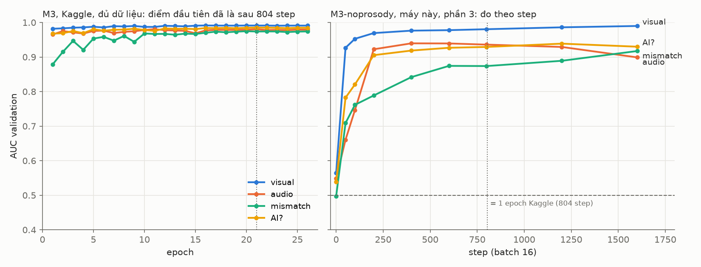
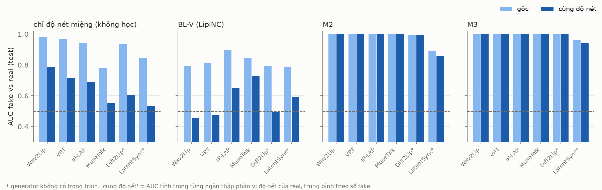
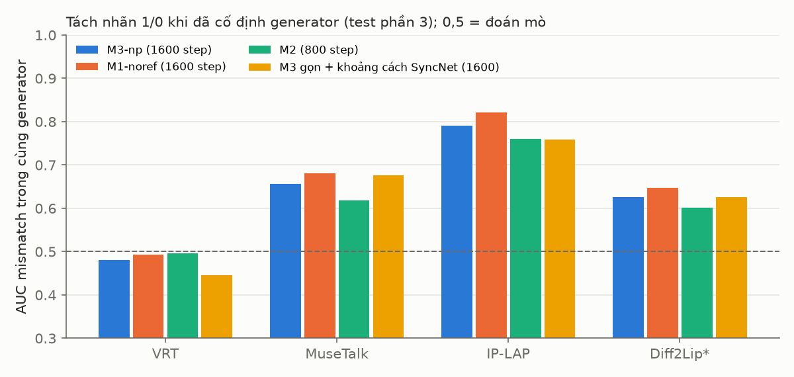

# v004 — Measured mismatch labels and the M3 lip–audio–head detector

Closed **7 November 2026**. Status: **trained and tested once on Kaggle** (3 parts, seed 42): M3, its prosody ablation, M2 and five baselines. The post-hoc review that followed on a local GPU, and the decision to move to v005, are in §6–§8.

How this report is organised:
- §1–§3: what v004 changed relative to v003 (labels, model, protocol).
- **§4: results on Kaggle**. §5: pre-registered gates.
- §6: post-hoc review (local, part 3): shortcuts, the mismatch head, and robustness to re-compression.
- §7: limitations. §8: what v005 changes.
- Raw generated report: [`v004_results/report.md`](v004_results/report.md) (Vietnamese); gates: [`v004_results/gates.json`](v004_results/gates.json).

Evidence marks:
- **●** measured on our data;
- **✔** read in the source (paper or code);
- **◐** abstract or secondary source;
- **○** inference, not checked.

Numbers without a mark are ● on the v004 test set (3 parts, 31 speakers, 7,368 clips, seed 42).

---

## 0. Summary

v004 keeps the v003 benchmark (six audio-visual cells, unseen generators and voices at test time) and retrains everything on **all three parts** (120 speakers, 23,242 clips). It changes three things:
1. **Measured mismatch labels.** In v003 a lip-sync clip was "not mismatched" by construction. v004 measures each lip-synced clip with SyncNet at lag 0 and labels it mismatched above the 95th percentile of real training clips (§1).
2. **M3 (`trihead_v4`)**, a new detector. It extends the three-head design of M1 with:
   - a relative / absolute split of the sync stream, so the visual head cannot read the generators' fixed delay;
   - an AVH-Align Φ channel in the cost volume;
   - a type head that predicts the cell;
   - a new **prosody ↔ head-motion branch** ("lip–audio–head triangle"): when the audio is replaced, the head keeps moving with the original sentence (§2).
3. **Protocol.**
   - Checkpoints and early stopping use validation AUC instead of validation loss.
   - Each model is tested right after training (test uses are logged).
   - Pre-registered gates with speaker-level bootstrap CIs.
   - A delayed-audio stress test.

**Results (§4–§5).**

| | AI? (fake vs real + sham) | Comparison | ΔAUC [95% CI] |
|---|---|---|---|
| **M3** | **0.968** | vs BL-Ens-AV (late fusion of BL-M/sup + BL-A2) | +0.038 [+0.031; +0.045] |
| | | vs M2 | +0.041 [+0.033; +0.050] |
| M3 without the prosody branch | 0.971 | **V9: the prosody branch does not help** | −0.003 [−0.006; −0.001] |

- **Unseen generators, AI?:** M3 0.975, BL-Ens-AV 0.903. On LatentSync: 0.953 vs 0.836.
- **Operating point** (threshold = 5% FPR on validation reals): M3 TPR 0.847 at 1.2% test FPR.
- **Delayed-audio stress test:** M3 is not fooled by delayed real audio (AUC 0.52–0.53 at +2…+4 frames); BL-M flags 99–100% of such clips.

**What the post-hoc review found (§6, local, part 3, ●).**
- The visual head is easy for a reason: mouth sharpness and a whole-frame trace of the fake pipeline.
- The mismatch head mostly detects "is lip-synced", not the misalignment itself.
- All detectors, ours included, **collapse under real re-compression**:
  - M3-lean AI? 0.965 (clean) → 0.900 (480p) → 0.761 (360p);
  - with the clean threshold, real clips are flagged at 20% (480p) and 93% (360p).

These findings define v005 (§8).

---

## 1. Measured mismatch labels

- **Why.** In v003, mismatch = 1 only for sham and AI-voice cells. Lip-sync cells were 0 by construction. Yet Wav2Lip (+3 frames) and VideoReTalking (+2) produce a fixed audio delay that real clips do not have ●.
- **Rule (chosen 3 November 2026):**
  - one meter, SyncNet distance at lag 0;
  - one threshold, the 95th percentile of real training clips (10.85);
  - no mask in training.
- **Augmentation.** Audio is shifted by −2…+5 frames during training and the mismatch label is recomputed after the shift, so a shifted real clip becomes "mismatched, not AI".
- **Resulting share of mismatch = 1 among lip-synced clips:**

| Generator | Wav2Lip | VideoReTalking | MuseTalk | Diff2Lip | IP-LAP | LatentSync |
|---|---|---|---|---|---|---|
| mismatch = 1 | 100% | 88.4% | 75.6% | 5.2% | 4.8% | 0% |

- Labels are therefore largely set by the generator. The two test-only generators (Diff2Lip, LatentSync) have almost no positives, so mismatch detection on unseen generators can only be read as a false-alarm rate.
- **Other datasets.** No public dataset we checked labels mismatch by measurement:
  - FakeAVCeleb, AV-Deepfake1M and AVLips label by construction (✔ / ◐);
  - DFDC and LAV-DF not checked.

## 2. Models

| Name | Role |
|---|---|
| `lipinc_v2` (BL-V) | LIPINC-V2, mouth-region vision transformer |
| `xlsr_frozen` (BL-A2) | frozen XLS-R 300M, learned mix of 5 layer groups (all 24 layers) + 2 attention layers; replaces BL-A, which did not learn in v003 |
| `avh_align` (BL-M), `avh_align_sup` (BL-M/sup) | AVH-Align (reals only / with labels), initialised from the released AV-1M checkpoint |
| `speechforensics` (BL-SF) | SpeechForensics, no training |
| `bl_ens_av` (BL-Ens-AV) | max(z BL-M/sup, z BL-A2), z from validation reals; no training |
| `avh_align_plus` (M2) | unchanged from v003 |
| `trihead_v4` (**M3**) | see below |
| `trihead_v4_no_prosody` | M3 without the prosody ↔ head branch (gate V9–V11) |

M1 (`trihead_v2`) was deferred by decision on 3 November and not trained. BL-A (`ssl_aasist`) and the other M3 ablations (`_no_phi`, `_abs`, `_ref`) were optional and not run.

**M3 streams and heads:**

```
sync        = ±15-frame cost volume [Pv·Pa, cos, Φ_AVH-Align] → 2D CNN → per-frame lag, sharpness, entropy
              relative stream (lag − clip mean) → visual head;  absolute stream → mismatch head
appearance  = Linear(AV-HuBERT visual) → TCN
prosody–head = [F0, voicing, energy, Δ] ‖ [eyebrows, Δ, head yaw/pitch/roll velocity] → ±12-frame cos volume → TCN
trace       = 96 px mouth crop + lip kinematics + head pose (as M1)
audio       = XLS-R, 5 layer groups → attention
heads       : visual ← trace + relative sync + appearance + prosody–head
              audio  ← audio;  mismatch ← absolute sync + audio + prosody–head
              offset (aux, real clips), type (6 cells, aux), speaker-confusion (bounded)
AI? = max(visual, audio)
```

The prosody branch borrows from phonetics: head and eyebrow motion follow F0 and energy (◐ Yehia et al. 2002; Burnham et al. 2024 for Cantonese tones). We did not find this pair used for lip-sync detection (searched in English, Chinese, Korean, Japanese and Vietnamese, 1 November). A hand-crafted check before training already showed no signal: cell AUC 0.43–0.58, none significant after Bonferroni.

## 3. Data and protocol

| Split | Clips | Speakers | real / sham / voice / source / donor / both |
|---|---|---|---|
| train | 12,858 | 72 | 1,440 / 2,842 / 2,880 / 1,924 / 1,870 / 1,902 |
| validation | 3,016 | 17 | 340 / 668 / 680 / 456 / 434 / 438 |
| test | 7,368 | 31 | 620 / 1,222 / 1,860 / 1,238 / 1,208 / 1,220 |

- **Train-only vs test-only methods.**
  - Generators seen in training: Wav2Lip, MuseTalk 1.5, IP-LAP, VideoReTalking. Test only: LatentSync 1.5, Diff2Lip.
  - Voices seen in training: VieNeu, F5-TTS (vi), OmniVoice, Seed-VC. Test only: VoxCPM2, viXTTS, F5 inpainting.
- **Checkpoints and stopping.**
  - Checkpoint = epoch with the best mean validation AUC over the model's heads.
  - Our models use ReduceLROnPlateau (×0.1 after 2 epochs) and stop after 5 epochs without improvement.
  - Baselines keep their original recipes.
- **Compute (Kaggle T4, ●):**
  - M3 and M3-noprosody needed four 11-hour sessions (P1–P1d). M3 stopped at epoch 26, best epoch 21, 34.5 h in total.
  - P2 per model: BL-M/sup 4.3 h, BL-A2 2.8 h, BL-V 1.1 h, M2 1.4 h, BL-M 0.2 h.
- **Why M3 was slow.** M3 ran ~4.1 s/step against 0.42 s of compute measured in the benchmark: the data loader, not the GPU, was the bottleneck (○ disk reads from `/kaggle/input`).

## 4. Results (test, 3 parts, seed 42)

### 4.1. AUC per task

| Model | AI? | visual | audio | mismatch |
|---|---|---|---|---|
| BL-M (`avh_align`) | 0.382 | 0.225 | 0.602 | 0.898 |
| BL-SF | 0.490 | 0.456 | 0.513 | 0.668 |
| BL-V | 0.608 | 0.662 | 0.472 | 0.437 |
| BL-A2 | 0.742 | – | 0.963 | – |
| BL-M/sup | 0.871 | 0.912 | 0.530 | 0.432 |
| M2 | 0.927 | – | – | 0.957 |
| BL-Ens-AV | 0.930 | 0.912 | 0.963 | – |
| **M3** | **0.968** | **0.992** | 0.959 | **0.968** |
| M3 −prosody | 0.971 | 0.992 | 0.959 | 0.961 |

**By method (AI?):**

| Model | LatentSync* | Diff2Lip* | unseen generators | seen generators | AI voice cell | F5 inpainting* |
|---|---|---|---|---|---|---|
| BL-Ens-AV | 0.836 | 0.970 | 0.903 | 0.984 | 0.937 | 0.878 |
| M2 | 0.866 | 0.979 | 0.922 | 0.994 | 0.950 | 0.929 |
| M3 | 0.953 | 0.997 | 0.975 | 0.999 | 0.927 | 0.861 |

\* not seen in training.

BL-A2 alone remains the strongest detector of unseen AI voices: audio AUC 0.963. M3's audio head is not better (gate V6: −0.005, CI includes 0).

### 4.2. Operating point (threshold = 5% FPR on validation reals)

| Model | TPR | test FPR | precision at 10% fakes | false alarms / 1000 reals |
|---|---|---|---|---|
| BL-Ens-AV | 0.620 | 0.026 | 0.725 | 26 |
| M2 | 0.774 | 0.059 | 0.595 | 59 |
| **M3** | **0.847** | **0.012** | **0.883** | **12** |

### 4.3. Delayed-audio stress test (real test clips shifted by k frames)

| Model | false alarms k=0 | k=+3 | AUC shifted vs original, k=+3 |
|---|---|---|---|
| BL-M | 0.029 | 1.000 | 0.995 |
| M2 | 0.052 | 0.045 | 0.432 |
| M3 | 0.011 | 0.011 | 0.530 |

The relative sync stream works as designed: M3's visual verdict does not change when real audio is delayed.

### 4.4. Type head and localisation

- **Type head (M3): accuracy 0.818.** The main confusion: 443 of 1,860 AI-voice clips are called "sham". The visual side agrees there is no AI mouth, and the audio head does not separate an unseen voice from a spliced real one.
- **Localisation stays weak for every model.** AP@0.5 for segment detection: M3 0.017, M2 0.022. Inside a partial clip, the highest-scoring visual frame falls inside the fake segment in 98.6% of clips (M3).

## 5. Gates (ΔAUC, speaker-level bootstrap, 31 speakers)

| # | Comparison | Task | ΔAUC [95% CI] | Verdict |
|---|---|---|---|---|
| V2 | M3 − BL-Ens-AV | AI? | +0.038 [+0.031; +0.045] | pass |
| V3 | M3 − M2 | AI? | +0.041 [+0.033; +0.050] | pass |
| V6 | M3 − BL-A2, unseen voices | audio | −0.005 [−0.012; +0.001] | fail |
| V7 | M3 − BL-M | mismatch | +0.070 [+0.063; +0.077] | pass |
| V9 | M3 − M3-noprosody (needs ≥ 0.01) | AI? | −0.003 [−0.006; −0.001] | **fail** |
| V10 | same, donor cell | visual | −0.000 [−0.001; +0.000] | fail |
| V11 | same | mismatch | +0.007 [+0.005; +0.009] | below the 0.01 bar |

V1 (vs M1), V4 (Φ), V5 (speaker references) and V8 (absolute sync) were not run.

## 6. Post-hoc review (local RTX 3050 Ti, part 3 only, 800–1,600 steps)

These runs use part 3 only (train 4,314 clips / 24 speakers, test 2,640 / 11 speakers) and features copied from the Kaggle caches.
- **Seed noise.** One seed unless stated. With two seeds, the compressed-test AUC varies by 0.01–0.03, so differences below that are noise ○.
- **Missing waveform.** No waveform cache was copied, so runs that need the prosody branch use M3-noprosody.

### 6.1. The high epoch-1 AUC is mostly the epoch axis

One Kaggle epoch is 804 steps. Measured per step, every head starts near 0.5; with shuffled labels the result is 0.44–0.59 (no label leak).

- **Audio and mismatch learn gradually.**
- **Visual is genuinely easy:** 0.89 after 10 steps, 0.93 after 50.



### 6.2. Why the visual head is easy

- **Mouth sharpness alone** separates real from lip-synced clips at AUC 0.78–0.98.
- **Whole-frame trace.**
  - Full lip-synced clips also differ from their source outside the mouth: upper face by 2.9–5.6 / 255, background by 1.3–3.4.
  - Sham clips differ by exactly 0.
  - So the fake pipeline leaves a whole-frame trace (○ re-encoding / pasting back).
- **Sharpness-matched test.**
  - BL-V drops to ~0.5: it mostly measured blur.
  - M2 and M3 stay near 1.0, except on LatentSync (M3 0.94, M2 0.86).



### 6.3. The mismatch head learns "is lip-synced"

- **Within one generator, mismatch AUC is 0.45–0.82** for every model; on VideoReTalking it is ~0.5.
- **Adding a continuous SyncNet-distance regression** cuts false alarms on label-0 lip-sync clips from 44–56% to 4–6%. It also catches far fewer label-1 clips (IP-LAP 0.85 → 0.10). Within-generator AUC is unchanged.



### 6.4. Simplifying M3

Run at 800 steps, M3-noprosody as reference (AI? 0.951):
- **Speaker-confusion loss:** dropping it changes nothing (0.952). Its loss stays at ≈ ln 72 for the whole run.
- **Visual streams:** each stream alone gives 0.937–0.946; dropping appearance gives 0.947.
- **Φ channel:** dropping it gives 0.944 and saves 2.0 M parameters.
- **XLS-R layer-drop 0.4 (new):** keeps audio at 0.930 and raises partial-sham AUC from 0.783 to 0.849.

"M3-lean" = trace + relative sync, no prosody, no appearance, no speaker loss, with layer-drop. At 1,600 steps it reaches AI? 0.956 (M3-noprosody 0.952).

### 6.5. Robustness to real re-compression

- **Test copies.** A private Kaggle kernel re-encoded 1,000 test clips with ffmpeg (libx264 veryfast + AAC):
  - c720: 720p, CRF 28, 96 kbps;
  - c480: 480p, CRF 30, 64 kbps;
  - c360: 360p, CRF 35, 32 kbps.
- **Features.** Extracted again from the re-encoded clips, with the original landmarks.
- **AI?, same 1,000 clips:**

| Model (trained on clean data) | clean | c480 | c360 |
|---|---|---|---|
| BL-Ens-AV | 0.938 | 0.854 | 0.702 |
| BL-A2 | 0.756 | 0.750 | 0.732 |
| M2 | 0.931 | 0.874 | 0.754 |
| M3-lean | 0.965 | 0.900 | 0.761 |

- **What fails.** Audio stays robust (~0.95 / 0.94 / 0.92). The visual head treats re-compressed reals as fake: the mean visual score of real clips rises from 0.04 (clean) to 0.47 (c480) and 0.98 (c360). max(visual, audio) then drags down the AI-voice cell (M3-lean at c360: 0.516).
- **Calibration.** With the threshold set on clean validation, M3-lean flags 20% of real + sham clips at c480 and 93% at c360.
- **Tried and rejected (synthetic degradations do not transfer to real codecs):**
  - "equalize": blurring or downscaling only real mouths during training;
  - JPEG on mouth crops.

## 7. Limitations

- **One seed** on Kaggle. CIs cover speaker sampling only, not training noise.
- **Saturated validation** (0.97–0.98 from early epochs), because it contains only seen generators and voices. Checkpoint choice therefore barely matters and says little about generalisation.
- **Mismatch labels are largely set by the generator** (§1). They cannot be evaluated on the two test-only generators.
- **The visual head relies partly on a pipeline trace** (sharpness, whole-frame re-encoding). We cannot yet tell "AI-painted lips" from "went through the generation pipeline"; this needs re-encoded real negatives.
- **Not covered:** fully generated talking heads (text-to-video). One external clip suspected to be T2V was caught only by the audio head ○.
- **Unvalidated estimates:** hour estimates in `settings.TRAIN_GROUPS` were 3–5× too low for M3 (data loading).

## 8. What v005 changes

v005 (on `main`) keeps the data, labels and baselines, and replaces M3 with **M3-R** (`trihead_v5`), designed for re-compressed video:
- **M3-lean backbone**: trace + relative sync, no prosody / appearance / speaker loss, XLS-R layer and channel dropout, sham clips as hard negatives for the visual head.
- **Training on real re-encoded copies (480p)**, paired with their clean clip, plus a **consistency loss**: on the compressed copy, predictions and pooled visual features must match those of the clean clip.
- **Same-protocol baselines.** Baselines are also trained with compressed copies. Every model is additionally tested on 480p re-encoded test clips, with false-alarm rates at the clean threshold.

Design, local evidence (2 seeds) and the training plan are in the v005 notes on `main`.
