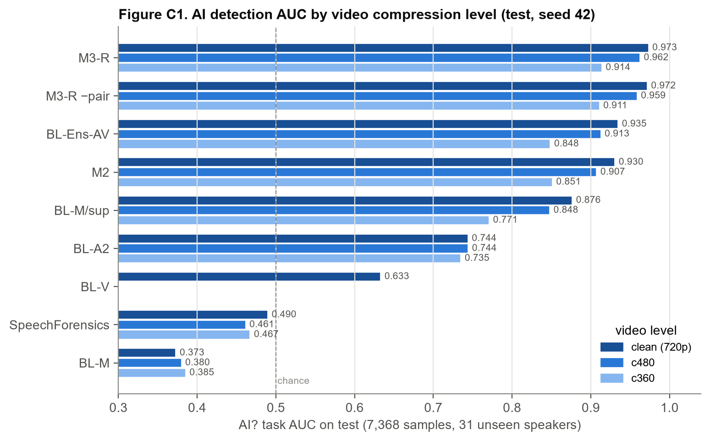
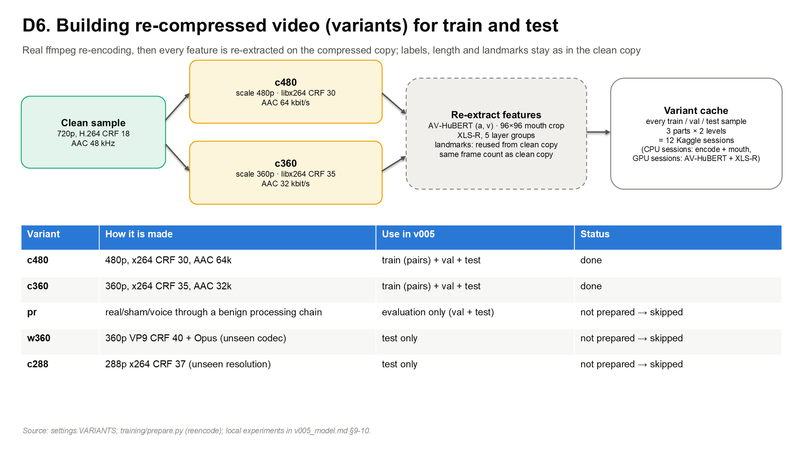
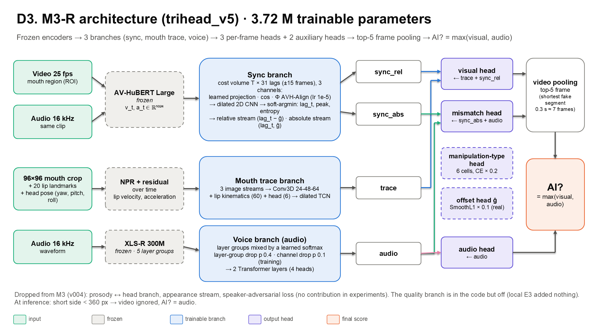
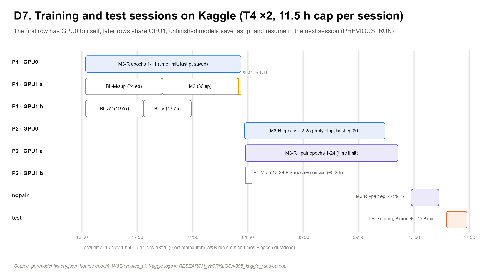
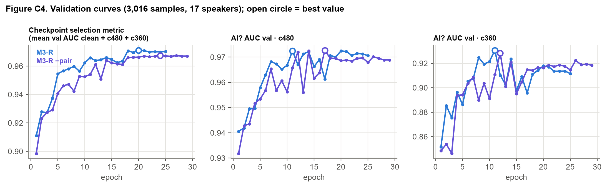
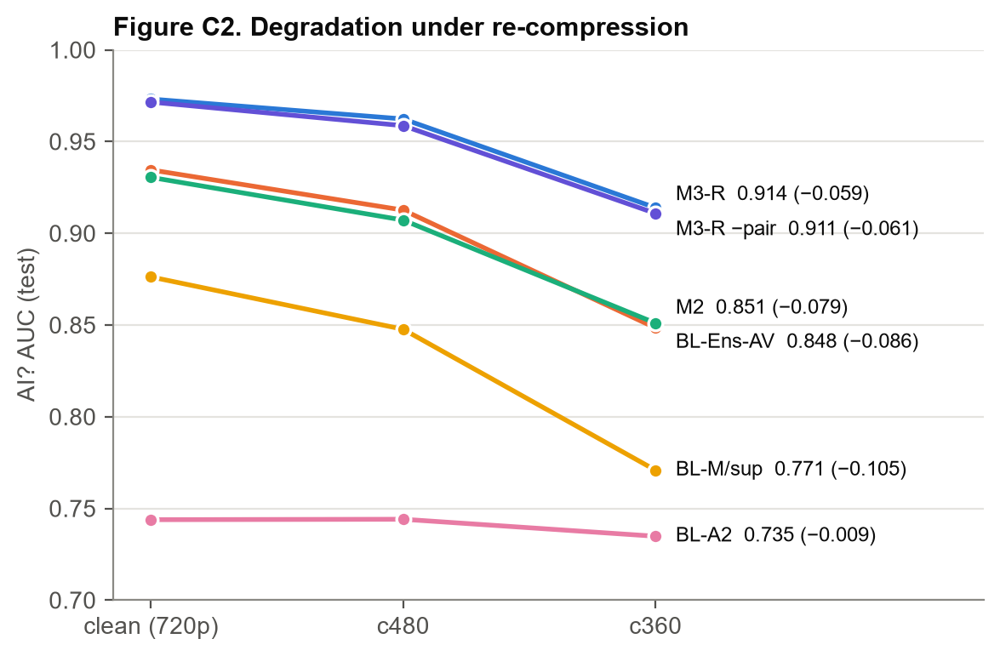
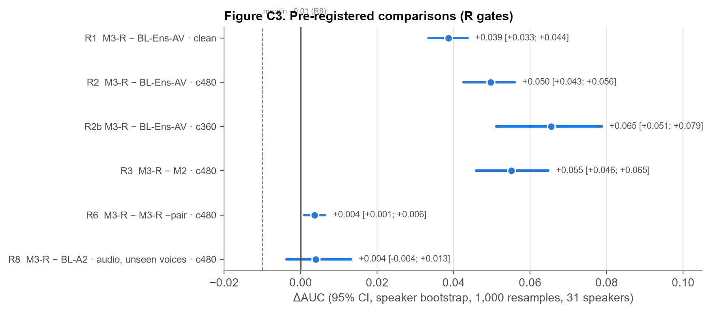
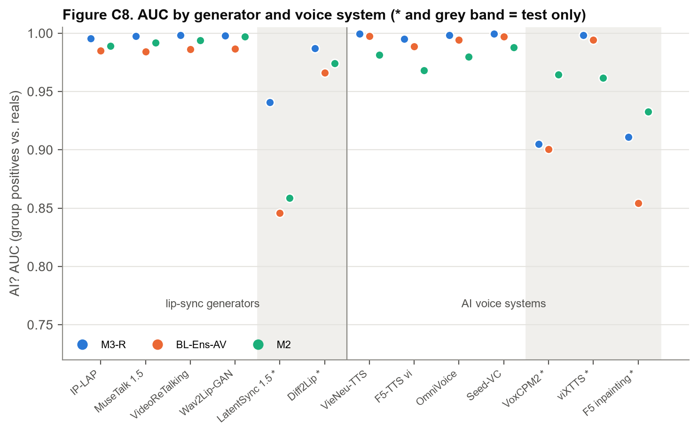
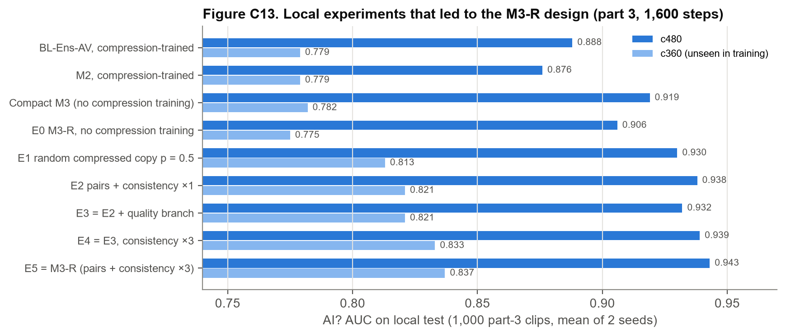

# v005 — M3-R: a lip-sync deepfake detector that survives re-compression

Closed **11 November 2026**. Status: **trained and tested once on Kaggle** (3 parts, seed 42): M3-R, its no-pair ablation, M2 and five baselines, each also evaluated on re-encoded 480p and 360p copies of every test clip.

How this report is organised:
- §1: why v005 exists (what v004 left open).
- §2: data added in v005 (real re-compression).
- §3: the M3-R model and its paired training.
- §4: training on Kaggle.
- **§5: test results and pre-registered gates.**
- §6: checks on what the detector relies on.
- §7: limitations and what is not done.
- Raw generated report: [`v005_results/report.md`](v005_results/report.md) (Vietnamese); gates: [`v005_results/gates.json`](v005_results/gates.json); test-use log: [`v005_results/test-log.json`](v005_results/test-log.json).

Evidence marks:
- **●** measured on our data;
- **✔** read in the source;
- **○** inference, not checked.

Numbers without a mark are ● on the v005 test set (3 parts, 31 unseen speakers, 7,368 clips, seed 42).

---

## 0. Summary

| AI? AUC (test) | clean 720p | 480p (CRF 30) | 360p (CRF 35) |
|---|---|---|---|
| **M3-R** (paired clean ↔ re-encoded training + consistency loss) | **0.973** | **0.962** | **0.914** |
| M3-R without pairing (random re-encoded copies, no consistency) | 0.972 | 0.959 | 0.911 |
| BL-Ens-AV (late fusion of BL-M/sup + BL-A2) | 0.935 | 0.913 | 0.848 |
| M2 (AVH-Align+) | 0.930 | 0.907 | 0.851 |

| Gate | Comparison | ΔAUC [95% CI, speaker bootstrap] |
|---|---|---|
| R1 | M3-R − BL-Ens-AV, clean | +0.039 [+0.033; +0.044] ✓ |
| R2 | M3-R − BL-Ens-AV, 480p | +0.050 [+0.043; +0.056] ✓ |
| R2b | M3-R − BL-Ens-AV, 360p | +0.065 [+0.051; +0.079] ✓ |
| R3 | M3-R − M2, 480p | +0.055 [+0.046; +0.065] ✓ |
| R6 | M3-R − M3-R without pairing, 480p | +0.004 [+0.001; +0.006] ✓ (small) |
| R8 | M3-R − BL-A2, audio, unseen voices, 480p (non-inferiority, −0.01) | +0.004 [−0.004; +0.013] ✓ |

- **Robustness.** The margin over the strongest baseline grows with compression: +0.039 → +0.050 → +0.065. In v004, the same family of model fell from 0.965 to 0.761 at 360p (local, ●).
- **Pairing helps very little.** The consistency loss adds +0.004 AUC at 480p for twice the GPU time (21.3 h vs 12.8 h). One seed: the seed-to-seed spread measured locally at 480p (0.01–0.03) is larger than this effect.
- **Operating point.** With the threshold at 5% FPR on clean validation reals, M3-R flags 1.5% of clean test reals and 2.1% at 480p while catching 80–82% of fakes. At 360p it flags 8.5% of reals (target 5%); a 360p-specific threshold brings this to 1.5% but recall drops to 41%.
- **Mismatch ≠ AI.** M3-R scores sham clips (real audio from another take, no AI) *lower* than reals (AUC 0.42). It is not fooled by delayed real audio (AUC 0.52–0.53 at +2…+4 frames). BL-M flags sham as fake (0.98).
- **Weak spots.** Unseen voices VoxCPM2 (0.905) and F5 inpainting (0.911), where M2 is better (0.964, 0.933); 360p false alarms at a fixed threshold.

---

## 1. Why v005

| v004 finding (●) | Consequence in v005 |
|---|---|
| M3 AI? 0.968, +0.038 over BL-Ens-AV, +0.041 over M2 (Kaggle, 3 parts) | keep the M3 frame |
| Prosody ↔ head branch does not help (V9 −0.003); appearance stream, speaker adversary and Φ add nothing measurable | **remove** → lean M3 |
| Real re-compression breaks every detector: lean M3 0.965 → 0.900 (480p) → 0.761 (360p); real clips flagged 20% / 93% at the clean threshold | **train on real re-encoded video** |
| Blur / JPEG simulated on the mouth crop does not transfer to real compression | use real ffmpeg re-encoding, not simulation |
| Post-hoc quality calibration helps 360p but hurts clean / 480p | not used |
| M3 took 34.5 h on Kaggle because data was re-read from `/kaggle/input` every epoch (~20 MB/s) | stage caches to local disk with 64 threads (`training/stage.py`) |

## 2. Data added in v005

The six cells, speakers, generators and voices are those of v004 (120 speakers, 23,242 clips; train / validation / test 12,858 / 3,016 / 7,368; 72 / 17 / 31 speakers). v005 adds re-encoded copies of **every** sample (`settings.VARIANTS`):

| Variant | Re-encoding | Used for | Status |
|---|---|---|---|
| `c480` | 480p, libx264 CRF 30, AAC 64 kbps | training (paired) + validation + test | done (●) |
| `c360` | 360p, libx264 CRF 35, AAC 32 kbps | training (paired) + validation + test | done (●) |
| `pr` | real / sham / voice through benign codec / rescaling chains | evaluation only | **not prepared** in this round |
| `w360` | 360p VP9 CRF 40 + Opus (unseen codec) | test only | **not prepared** |
| `c288` | 288p libx264 CRF 37 (unseen resolution) | test only | **not prepared** |

Each variant is re-extracted from the re-encoded file (AV-HuBERT, mouth crops, XLS-R), keeping the clean landmarks and the frame count so frame labels stay valid. This takes 12 Kaggle sessions: 3 parts × 2 levels, each with a CPU session (re-encode + mouth) and a T4 session (AV-HuBERT + XLS-R).

## 3. M3-R (`trihead_v5`)

**Inputs (frozen).** AV-HuBERT Large lip video and audio features (1024-d, 25 Hz), 96×96 mouth crops with lip landmarks and head pose, and five XLS-R 300M layer groups.

**Branches.**
- **Sync:** a cost volume over lags δ ∈ [−15, 15] with three channels (learned projection dot product, cosine, AVH-Align Φ), then a dilated 2-D CNN and soft-argmin. It feeds two streams: a *relative* stream (lag minus clip mean, invariant to a constant audio delay) to the visual head, and an *absolute* stream to the mismatch head.
- **Trace:** three mouth image streams (raw, NPR, temporal residual) through Conv3D, plus lip kinematics and head pose, through a TCN.
- **Audio:** a softmax mix of the XLS-R layer groups (layer dropout 0.4, channel dropout 0.1 during training), followed by 2 Transformer layers.

**Heads.** Frame-level visual ← [trace, sync_rel], mismatch ← [sync_abs, audio], audio ← audio. Auxiliary heads: cell type (CE × 0.2) and global offset (SmoothL1 × 0.1, real clips). Video score = mean of the top-5 frames. **AI? = max(visual, audio).** 3.72 M trainable parameters, of which Φ is 1.74 M.

**Paired training (D5).** Each batch is 8 clips plus their own re-encoded copies (480p or 360p, drawn per epoch), with the same crop, lag shift and pseudo-fake. The loss is

L = L_task + 1·L_sham + 3·L_cons

- **L_task:** frame + video BCE on both halves, plus the auxiliary heads.
- **L_sham:** BCE of the sham clips' visual score toward 0. Misalignment without AI must not raise the visual score.
- **L_cons:** MSE between σ(visual), σ(mismatch) of the re-encoded copy and a stop-gradient copy of the clean prediction, plus 1 − cos between their pooled trace / sync_rel features.

The no-pair ablation has the same model and data, but uses random re-encoded copies (p = 0.5), independent batches of 16 and no L_cons.

**Resolution gate (inference).** If the short side is below 360 px, the visual evidence is skipped and AI? = audio. This rule was fixed before looking at 288p results: locally, AUC visual is about 0.51 for every model at 288p.

## 4. Training on Kaggle

| Session | Commit | Result (●) |
|---|---|---|
| P1 | `8d5157e` | GPU0: M3-R epochs 1–11 (time limit, `last.pt`). GPU1: BL-M/sup, BL-A2, BL-V, M2 finished; BL-M paused at epoch 11 |
| P2 | `a8d3515` | M3-R epochs 12–25, early stop (best epoch 20, selection metric 0.9711); no-pair epochs 1–24 (time limit); BL-M and SpeechForensics finished |
| single step | `b945b4a` | no-pair epochs 25–29, early stop (best epoch 24, 0.9674) |
| test | `b945b4a` | 8 models × 3 levels scored in 75.8 min; each model used the test set once (`test-log.json`) |

- **Selection metric:** mean over the model's heads of validation AUC, averaged over clean, 480p and 360p.
- **Optimizer:** AdamW, lr 3e-4 (Φ 1e-5), weight decay 1e-4, batch 16.
- **Schedule:** plateau ×0.1 after 2 epochs; early stop after 5 epochs.

GPU hours (sum of epoch times, ●): M3-R 21.3, no-pair 12.8, M2 5.5, BL-M/sup 5.5, BL-A2 4.2, BL-V 3.4, BL-M 0.5.

## 5. Results

**Test AUC, clean video (●).**

| Model | AI? | visual | audio | mismatch | AP | EER |
|---|---|---|---|---|---|---|
| **M3-R** | **0.973** | **0.992** | **0.966** | **0.972** | **0.992** | **0.076** |
| M3-R without pairing | 0.972 | 0.992 | 0.964 | 0.971 | 0.991 | 0.082 |
| BL-Ens-AV | 0.935 | 0.903 | 0.964 | – | 0.978 | 0.125 |
| M2 | 0.930 | – | – | 0.964 | 0.976 | 0.135 |
| BL-M/sup | 0.876 | 0.903 | 0.542 | 0.443 | 0.960 | 0.213 |
| BL-A2 | 0.744 | – | 0.964 | – | 0.914 | 0.333 |
| BL-V | 0.633 | 0.700 | 0.466 | 0.438 | 0.841 | 0.409 |
| SpeechForensics | 0.490 | 0.456 | 0.513 | 0.668 | 0.714 | 0.502 |
| BL-M | 0.373 | 0.206 | 0.608 | 0.909 | 0.652 | 0.622 |

BL-M and SpeechForensics score below 0.5 on AI? by design. They measure audio-visual sync only, so they rank sham clips (misaligned, no AI) as fake; v004 gave the same picture (BL-M 0.382).

 

**Per head under compression (M3-R).** The audio head barely moves (0.966 → 0.964 → 0.946). The loss is in the visual head (0.992 → 0.979 → 0.932), consistent with the local finding that at 360p the mouth crop and AV-HuBERT features are out of domain. It is not a "blur = fake" shortcut: locally, high-resolution reals that were blurred were flagged in 0 of 24 cases.

**Operating points (threshold = 5% FPR on clean validation reals, ●).**

| Model | TPR / FPR clean | 480p | 360p | 360p with a 360p threshold |
|---|---|---|---|---|
| M3-R | 0.817 / 0.015 | 0.800 / 0.021 | 0.773 / 0.085 | 0.409 / 0.015 |
| M3-R without pairing | 0.828 / 0.017 | 0.800 / 0.026 | 0.742 / 0.074 | 0.436 / 0.013 |
| BL-Ens-AV | 0.747 / 0.023 | 0.628 / 0.022 | 0.523 / 0.043 | – |
| M2 | 0.767 / 0.052 | 0.697 / 0.056 | 0.604 / 0.092 | 0.438 / 0.029 |

**Unseen generators and voices.**
- LatentSync: M3-R 0.941 vs BL-Ens-AV 0.846. Diff2Lip: 0.987. Seen generators: 0.997.
- Unseen voices: VoxCPM2 0.905, viXTTS 0.998, F5 inpainting 0.911. M2, which has no XLS-R branch, does better on VoxCPM2 (0.964) and F5 inpainting (0.933).

**Mismatch is not AI (●).**
- AUC of the AI? score, sham vs real (clean / 480p / 360p):
  - M3-R 0.422 / 0.390 / 0.371;
  - BL-Ens-AV 0.588 / 0.553 / 0.519;
  - M2 0.755 / 0.619 / 0.466;
  - SpeechForensics 0.885;
  - BL-M 0.984.
- Delayed real audio (+2…+4 frames), M3-R:
  - AI? AUC vs undelayed 0.518–0.529 (not fooled);
  - mismatch AUC 0.976–0.996 (the delay is reported as misalignment);
  - false alarms stay at 0.5%.
- The no-pair model is slightly more sensitive to delay (0.573–0.625).

**Other.**
- The cell-type head is correct on 83.3% of samples. Main confusions: voice → sham, source → real, donor ↔ source.
- Temporal localisation AP@0.5 is 0.023 for every model. v003 showed that the current proposal scheme caps even a perfect scorer at 0.01–0.03, so this metric needs fixing before it can be read.

## 6. What the detector relies on (local, part 3, ●)

These checks ran on a local GPU before the Kaggle run. Their test set is 1,000 part-3 clips (1,600–4,800 steps), so they are design evidence, not the headline numbers.

| Check | Result |
|---|---|
| Ablation E0 → E5 at 480p / 360p (only 480p trained) | no compression training 0.906 / 0.775; random copies 0.930 / 0.813; pairs + consistency ×3 **0.943 / 0.837**; quality branch adds nothing (0.932) |
| Training on 360p as well (4,800 steps) | 360p AUC 0.848 → 0.892, 360p false alarms 0.44 → 0.11; clean −0.001 |
| Shuffled training labels | test AUC 0.517: no label leak |
| MuseTalk held out of training entirely | MuseTalk AUC 0.950 (0.985–0.989 when seen) |
| Processed real (benign codec chains, 3 of 7 families unseen) | pipeline-matched AUC 0.985 = clean-negative AUC 0.984; 1–2% of processed reals flagged in seen and unseen families: the model does not read the fake-pipeline trace |
| Single streams | sync only 0.954 vs both 0.950 (clean); trace only 0.924: the signal is mostly lip–audio semantics |

## 7. Limitations and not done

- **One seed.** CIs cover speaker sampling only. The R6 effect (+0.004) is below the local seed spread.
- **Optional gates not run:**
  - R4 (M3-R trained on clean video only), which is needed to attribute the robustness to compression training on the full data;
  - R5 (quality branch);
  - R2c (VP9);
  - the processed-real table (`pr`, `w360`, `c288` were not prepared).
- **360p at a fixed threshold** flags 8.5% of reals.
- **Below 360p** only AI voices can be detected (resolution gate).
- **Unseen voices** VoxCPM2 and F5 inpainting stay around 0.91.
- **Not in the v005 roster:** M1 (`trihead_v2`) and M3 v004 (`trihead_v4`) were compared in earlier rounds before M3-R was chosen. Their code stays in `models.SPECS`.

## 8. Reproducing

- `settings.py` holds the roster (`MODELS`, `ABLATIONS`), `VARIANTS`, `TRAIN_GROUPS` and `TRAIN_SESSIONS`. Kaggle notebooks are generated by `tools/make_notebooks.py`.
- Training sessions: `P1`, `P2`, then `GROUP = "M3-R-nopair"` with `PREVIOUS_RUN` = P2 output, then `GROUP = "test"`. A session stops cleanly at `MAX_HOURS = 11.5` and the next one resumes from `last.pt`.
- Figures in `figures/v005/` come from the run outputs (charts) and from editable PowerPoint diagrams kept with the project report.
